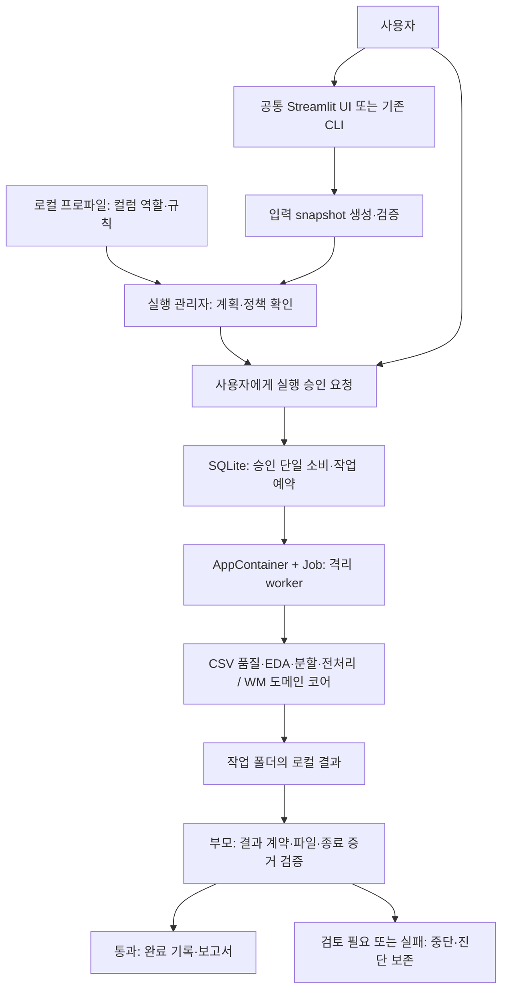
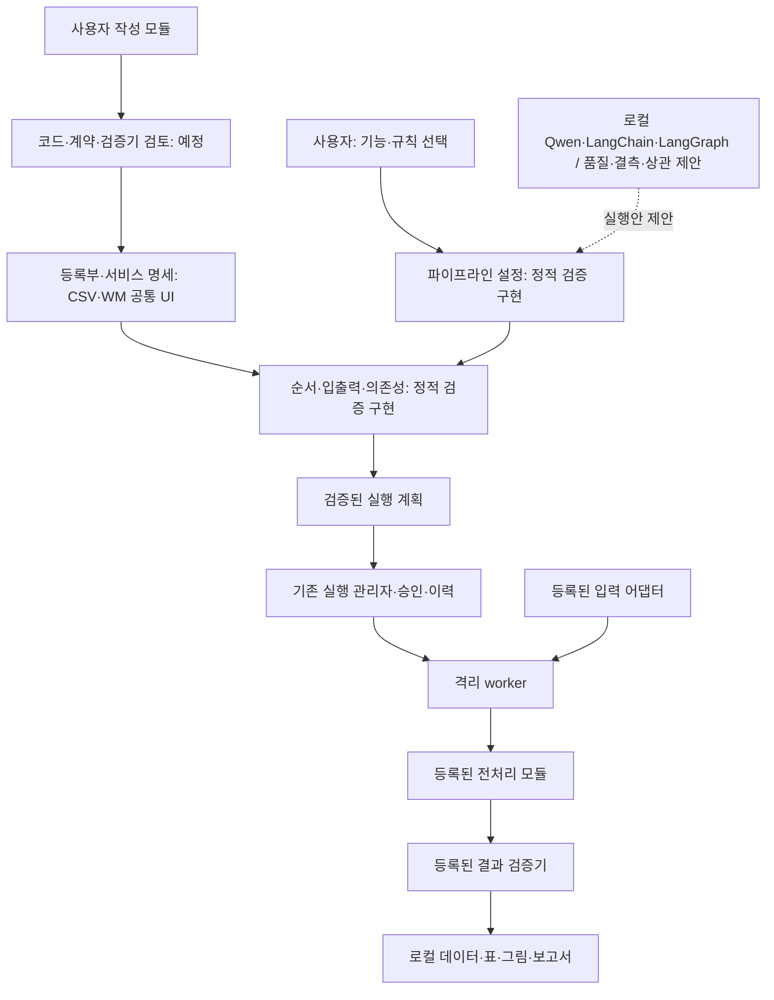

# 전처리 에이전트 구성도

현재 구현 상태와 읽는 순서는 [문서 안내](GUIDE.md)를 기준으로 합니다. 아래의 날짜별 설계·검증 기록은 해당 시점의 범위와 구분해서 읽습니다.

기준일: 2026-10-19. 현재 구현과 모듈형 확장 목표를 구분한다. CSV 공통 UI 5개 작업과 WM 정상 개발 6단계가 연결됐으며, 자연어 제안은 품질·결측·상관 분석으로 제한한다. 구성도에서 **예정**으로 표시한 부분은 아직 실행할 수 있는 기능이 아니다.

## 1. 전체 프로젝트에서의 위치

```text
WaferGuard
├─ 공통 로컬 UI            src/ui/
│  └─ 요청·제안 검토·입력 선택·사용자 승인·결과 표시
│
├─ 범용 전처리 코어         src/preprocessing/
│  └─ EDA·품질 검사·분할·변환·입력 계약·보고서
│
├─ 전처리 에이전트         src/agents/
│  └─ 실행 계획·사용자 승인·격리 실행·검증·이력 관리
│     위의 전처리 코어를 호출하며 모델을 학습하지 않음
│
├─ 센서 머신러닝           src/sensor_ml/
│  └─ SECOM 실험·모델 비교·평가·추론
│
└─ 웨이퍼 딥러닝           src/wafer_dl/
   └─ WM-811K 전용 데이터 처리·학습용 입력 준비
```

에이전트와 전처리 코어는 서로 다른 역할이다. 코어는 실제 계산을 담당하고, 에이전트는 무엇을 어떤 조건에서 실행할지 관리한다. 코어는 에이전트 없이 노트북·CLI에서도 사용할 수 있다.

범용 코어가 `agents`·`sensor_ml`·`wafer_dl`에 의존하지 않는 방향을 유지한다. 데이터별 차이는 프로파일과 어댑터로 연결하며, WM 맵 전용 분석을 모든 표형 데이터에 강제하지 않는다.

## 2. 현재 실제로 연결된 격리 실행 구조



공통 UI는 등록된 작업 명세에서 입력 폼과 서비스를 선택하고, 기존 CLI·실행 관리자·결과 검증기를 재사용한다. CSV는 품질·EDA·분할 → 구간 내보내기 → Train 기준 후보 → 저장 기준 적용 → 로컬 전달까지 사용자 실행을 확인했다. WM 정상 6단계도 같은 화면으로 연결했다. 로컬 전달 묶음은 worker가 아닌 검증된 파일 복사다. LLM 제안 경로는 품질·결측·상관 분석만 허용하며, 임의 사용자 코드나 전체 전처리를 자연어로 실행하는 기능은 아직 제공하지 않는다.

snapshot은 허용된 입력의 복사본이다. worker에 원본 폴더 전체나 승인 DB를 열어 주지 않는다. 부모는 결과의 구조·무결성·실행 증거를 검증하며, 일반 데이터 통계의 정답까지 독립적으로 다시 계산해 보증하는 것은 아니다.

## 3. 모듈형 구조와 남은 확장



실선도 모두 구현 완료를 뜻하지 않는다. 위 그림은 목표 구조이며 각 구성 요소의 현재 상태는 아래 표를 따른다. LLM은 모듈을 직접 실행하거나 권한을 부여하지 않는다. 실행안은 등록부·정책 검증과 사용자 승인을 거쳐야 한다. 원본·상세 통계·추측 가능한 데이터는 현재 정책상 LLM으로 보내지 않는다.

### 각 구성 요소가 맡는 일

| 구성 요소 | 쉬운 설명 | 현재 상태·위치 |
| --- | --- | --- |
| 입력 어댑터 | 파일을 읽고 공통 입력 형태로 바꾸는 입구 | `src/agents/adapters/`. snapshot worker의 실제 분석 연결은 CSV 중심 |
| 프로파일 | 숫자·범주·라벨·그룹 등의 역할과 규칙을 적은 설정 | `src/preprocessing/profiles.py`, `configs/agents/profiles/` |
| 전처리 모듈 | 결측률 계산·품질 검사·대치 등 실제 작업 | 코어 구현: `src/preprocessing/` |
| 통합 모듈 등록부 | 사용할 수 있는 기능의 ID·버전·설정·검증기를 모은 목록 | 계산 계약 등록부와 UI workflow 서비스 명세를 분리. 공통 UI 서비스는 WM 8개·CSV 5개 |
| 파이프라인 설정·검증 | 모듈 선택·연결·순서·선행 조건 확인 | 정적 검증·승인 작업 연결. 확정된 분할·후보·적용 결과는 전용 계약으로 이어 받음. 임의 출력 연결 일반화는 미지원 |
| 실행 관리자 | 승인 확인·한 단계 실행·취소·실패 중단 | `src/agents/executor.py` 등 구현 |
| 승인·이력 저장소 | 같은 승인의 중복 사용과 작업 충돌 방지 | `src/agents/approval_store.py` 등 구현 |
| 격리 worker | 제한된 입력·권한·자원으로 실제 코어 호출 | CSV 분할·전처리와 WM 정상 개발 흐름 연결. Windows 통합 Python 3.12 환경 지원 |
| 부모 결과 검증기 | worker가 만든 결과를 검증한 뒤 완료 여부 결정 | 도메인별 계약·해시·행 연결·실행 증거 검사. 통계 정답 보증이나 LLM 판정은 아님 |
| LLM 제안기 | 자연어 요청을 등록 기능과 설정의 제안으로 변환 | 로컬 Qwen·LangChain·LangGraph 연결. 현재 품질·결측·상관 분석 한정, 실행 승인 권한 없음 |

## 4. 전처리 모듈 안에는 무엇이 있는가?

```text
src/preprocessing/                    현재 파일 — 새 폴더를 만들겠다는 뜻이 아님
├─ contracts.py                      공통 입력·컬럼 역할 계약
├─ profiles.py                       데이터별 설정 읽기·검증
├─ eda.py                            결측·기술 통계·범주·라벨·상관관계 계산
├─ eda_report.py                     그림·CSV·JSON·Markdown 생성
├─ quality.py                        품질 규칙 검사·검토/차단 판단
├─ split.py                          분할 제안·검증·확정 관련 처리
├─ transform.py                      특징 제거·대치·스케일링·범주화·인코딩
├─ prepared_contract.py              전처리 산출물 계약 검증
├─ report.py                         로컬 보고서 구성
└─ workflows.py                      현재 고정 workflow 정의
```

초기 등록은 기존 `eda.py`와 `quality.py`부터 연결한다. `transform.py`는 먼저 복합 전처리 모듈 하나로 등록한다. 기능마다 즉시 파일을 새로 만들거나 기존 알고리즘을 다시 구현하지 않는다.

모듈 등록부에는 함수 자체 대신 **기능 ID·버전·계약·허용 설정·고정 구현 연결·결과 검증기**를 관리한다. 사용자 모듈도 검토 후 같은 규격에 등록하며, `.py`를 폴더에 넣는 것만으로 자동 실행하지 않는다.

## 5. 사용자 요청이 처리되는 예

요청: “결측률을 확인하고, 승인 후 50% 초과 특징을 제거한 다음 중앙값 대치해 주세요.”

1. 사용자가 설정을 직접 선택한다. 이후 LLM이 추가되면 같은 설정의 실행안을 제안할 수 있다.
2. 입력 어댑터·프로파일을 확인하고 EDA·품질 검사 결과를 만든다.
3. 전체 데이터의 진단 결과와 모델 입력용 제거 기준을 구분한다. 변환 기준이 필요하면 분할을 먼저 확정한다.
4. Train에서 산출할 제거·대치 규칙과 파생 출력 계획을 보여 주고 사용자가 승인한다.
5. 격리 worker가 기존 전처리 코어를 호출해 Train에서 기준을 산출·저장한다. Validation에는 저장 기준만 적용한다.
6. 결과 검증 후 새 데이터와 로컬 보고서를 제공한다. 원본은 보존한다.

이는 목표 흐름의 예시다. 현재 EDA·audit의 검토 필요 결과를 승인만으로 자동 해제하거나 곧바로 제거·대치까지 이어 가는 기능은 아직 연결하지 않았다.

## 6. 다음 구현 위치

내보내기 진행: [요청·worker·부모 파일 검증·승인 CLI·AppContainer+Job·커밋 연결](guides/PARTITION_EXPORT.md)을 구현·합성 검증했다. 실제 Windows 격리 실행은 아직 확인하지 않았다. Test 파일이나 전처리 통계는 생성하지 않지만 구간 추출을 위해 원본 CSV 전체는 순회한다.

진행 갱신: [확정 분할 증거·구간 입력 계약](design/PARTITION_INPUT_CONTRACT.md)에 승인·검증된 내보내기 결과를 연결한다. 다음은 합성 네이티브 실행 확인 이후 Train 전용 전처리 후보 기준 산출·적용 승인이다. 임의 CSV를 Train으로 선언하는 경로는 허용하지 않는다.

현재 [계약·등록부](design/MODULE_REGISTRY.md)·[정적 검증](design/MODULE_PIPELINE.md)·[승인·격리 실행 연결](guides/MODULE_PIPELINE_EXECUTION.md)의 합성 정상·검토 중단 경로를 실제 OS 기록까지 확인했다. 다음은 [변환 연결 계획](design/MODULE_TRANSFORM_PLAN.md)의 **확정 분할 증거·구간별 입력 계약**이다. 실데이터·변환·사용자 모듈 확장은 아직 완료하지 않았다.
