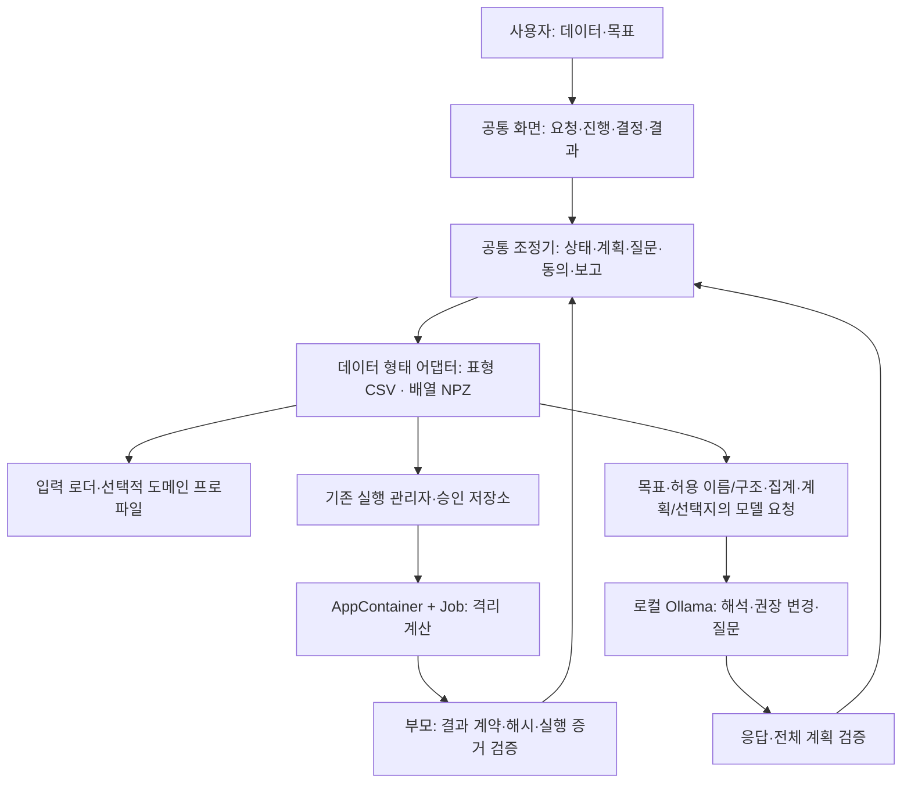
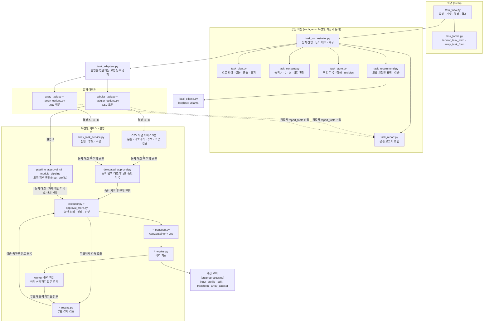
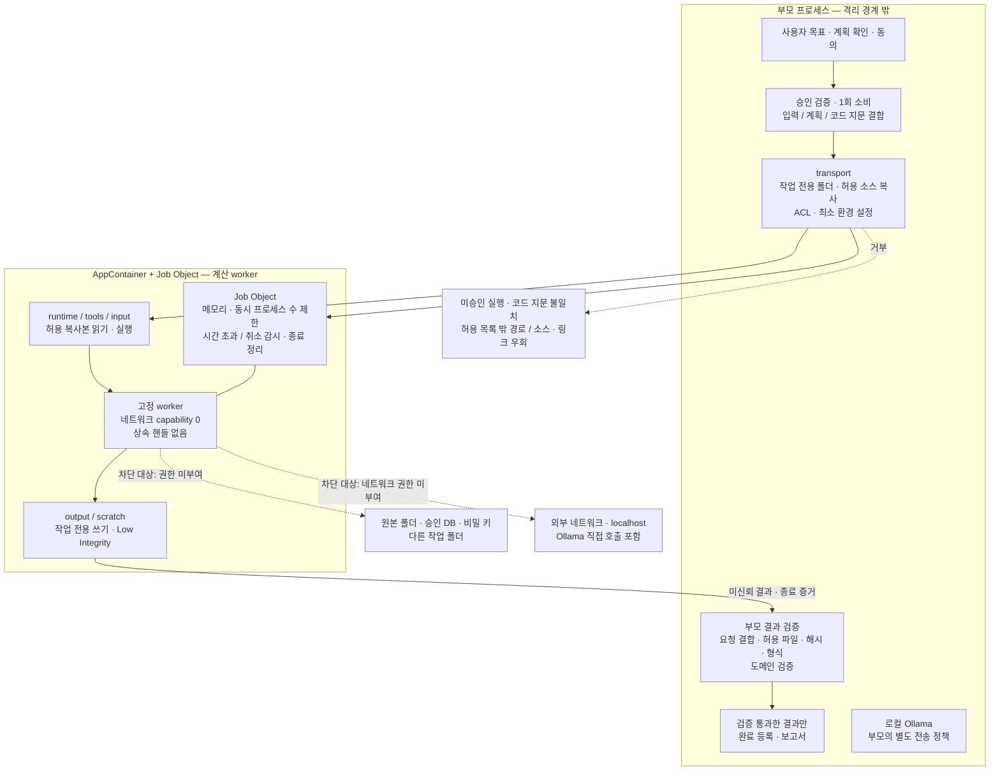

# 범용 전처리 에이전트 설계

에이전트의 단일 설계 기준이다. 현재 사용·검증 상태는 [GUIDE](GUIDE.md), 명령별 절차는 `guides/`, OS 설정·진단은 `security/`에서 확인한다. 기본·상세 설계, 구성도와 기능별 설계에 분산되었던 유효한 계약을 이 문서로 대체한다. 과거 설계·변경 과정은 Git 이력으로 확인한다.

## 읽는 방법

작업에 해당하는 절만 읽고 수정한다. 구현 이력·테스트 수치를 이 문서에 누적하지 않는다. 필드·상한·허용값의 정확한 정의는 아래에 연결한 계약 코드가 기준이며, 문서 변경만으로 기능을 활성화하거나 승인·검증을 완화하지 않는다. 사용자와 새로 확정한 정책은 구현 상태와 구분한다.

| 변경 영역 | 기준 절 |
| --- | --- |
| 공통 구조·유형 연결 | [책임 구분](#책임-구분), [내부 구조](#내부-구조), [배열·이미지 연결](#배열이미지-통합-작업-연결) |
| 입력·프로파일·헤더 정비 | [입력 계약](#입력-계약) |
| 권장안·질문·설정 확인 | [계획과 질문](#계획과-질문) |
| 실행·동의·위임 | [승인과 실행](#승인과-실행) |
| 등록·바인딩·기준 산출 | [모듈과 파이프라인](#모듈과-파이프라인) |
| 결과·복구·과거 실행 | [검증과 저장](#검증과-저장) |
| LLM·개인정보·격리 | [정보 전달](#정보-전달), [보안 기준](#보안-기준) |
| 다음 구현 | [후속 범위](#후속-범위) |

## 목표와 범위

데이터와 목적을 받으면 진단 → 권장안·필요한 질문 → 계획 확인 → 분할·전처리 → 적용 확인 → 결과까지 연결한다. 사용자에게 내부 실행 이름·경로·선행 결과를 수동 연결시키지 않는다. 실행 성공뿐 아니라 문제·실제 처리·전후 변화·미처리 사항·산출물이 이해되는 것을 완료 기준으로 삼는다.

현재 제품 통합 작업은 CSV 로더를 쓰는 표형 어댑터와 `.npz` 배열 어댑터다. 기존 등록 모듈·CLI의 WM 처리와 일반 pickle canonical 변환은 별도 경로이며, 웨이퍼 통합 프로파일을 의미하지 않는다. 모델 학습·Test 성능 평가·임의 코드 생성 실행은 수행하지 않는다. 코어는 에이전트 없이도 호출할 수 있다.

## 책임 구분

| 계층 | 책임·의존 방향 |
| --- | --- |
| 공통 핵심 | 조정·상태·잠금·작업 기록·질문·동의·진행·문제 처리·보고서·화면 틀. 유형별 모듈이나 WM 필드를 직접 알지 않는다 |
| 데이터 형태 어댑터 | canonical 입력·진단·허용 모델 집계·결정 스키마·기본 계획·검사·질문·서비스 연결·검증된 결과 요약. 현재 표형(CSV)과 배열(`.npz`) |
| 도메인 프로파일 | 형태 위에 분야 의미·라벨·그룹·전용 검사·모듈 카탈로그·계보 규칙을 더한다. 웨이퍼는 배열 위의 선택적 프로파일이지 데이터 형태가 아니다 |
| 로더·입력 매핑 | CSV, 구조 판별 pickle, WM-811K 필드 매핑. 형식 판별이 모호하면 질문하며 임의 추정으로 실행하지 않는다 |
| 계산 모듈 | `src/preprocessing/`와 기존 도메인 계산. 공통 코어는 `agents`·`sensor_ml`·`wafer_dl`에 의존하지 않는다 |

### 내부 구조

| 결정 | 화면에서 하는 일 | 조정기가 이어서 하는 일 |
| --- | --- | --- |
| A | 파일·목표 입력, 진단·모델 전달 범위 동의 | snapshot 복사 → 격리 진단 → 허용 목표·이름/구조·집계·계획/선택지로 모델 권장안 → 계획 확인 화면 |
| C | 역할·매핑·분할·전처리 수정, 질문 답변, 최종 계획 미리보기 후 동의 | 분할 → (CSV) 내보내기 → Train 기준 후보 → 예상 영향 표시 |
| D | 후보·경고 확인 후 적용 동의(또는 계획 수정으로 새 시도) | Train·Validation 적용 → 결과 묶음 → 공통 보고서 |

각 단계의 1회 승인은 해당 동의 범위·입력·계획·코드 지문과 맞을 때만 위임 발급한다. worker 출력은 부모 검증기를 통과한 것만 커밋하고, 화면·보고서는 검증된 결과만 다시 읽는다.

등록부 `task_adapters.py`는 유형별 어댑터를 import하는 의도된 연결 경계다. 조정·계획·동의·저장·보고서의 공통 규칙이 유형별 계산에 직접 의존하지 않는 것과 구분한다. 구성도의 연결은 주요 호출/처리 관계이며 모든 함수 호출·반환을 나타내지는 않는다. 표형 진단은 `pipeline_approval_cli.record_delegated_approval`에서 동의를 대조해 자체 위임 기록을 남기고 실행기를 거친다. CSV·배열 서비스의 공통 `delegated_approval` 경로와 구분하되, 모두 승인 소비 뒤 격리 계산하고 부모가 출력을 검증한다. `task_report`는 어댑터의 `report_facts`를 호출해 검증된 결과 사실을 받아 조립하며, 점선은 그 반환 자료를 나타낸다.

주요 구현은 `task_orchestrator.py`, `task_plan.py`, `task_consent.py`, `task_store.py`, `task_adapters.py`, `task_report.py`, `tabular_task.py`, `array_task.py`와 `src/ui/task_view.py`다. 등록은 고정 ID 목록을 사용하고 폴더 탐색·동적 import·새 에이전트 프레임워크를 도입하지 않는다.

### 배열·이미지 통합 작업 연결

**상태: 구현, 합성 검증 및 합성 입력의 실제 격리 실행·모델 요청·사용자 화면 확인 이력 있음.** 아래 확정 결정대로 `array_task*.py`·`array_options.py`·`src/preprocessing/array_dataset.py`·`src/ui/array_task_form.py`로 구현하고 통합 작업에 등록했다. 최신 bool 라벨 보완은 관련 합성 테스트까지 확인했으며, 전체 회귀·실제 OS 재실행은 별개다. 검증 근거·모델 품질 한계·네트워크 검증 범위 등 현재 범위는 [운영 안내](GUIDE.md#검증-상태와-남은-제한)를 따른다. 웨이퍼 전용 규칙(WM-811K 필드·결함 맵 채널·lot 규칙)과 시간 처리는 이 범위가 아니다. WM-811K 매핑의 `waferMap`·`failureType`·`lotName`은 이후 웨이퍼 프로파일 안에만 둔다.

**재사용 판정(코드 확인)**

| 대상 | 판정 |
| --- | --- |
| `task_orchestrator`·`task_plan`·`task_consent`·`task_store`·`task_recommend`·`task_report`, `task_forms.generic_form` | 그대로 재사용. 어댑터 함수 집합은 테스트 전용 `tests/agents/array_task_fixture.py`로 이미 끝까지 검증됨 |
| `input_snapshot`(단일 파일 복사), 승인 저장소·`RulesExecutor`·`delegated_approval.record_delegated`·`workflow_approval`, AppContainer·Job 실행·`worker_contract` | 그대로 재사용 |
| `split._partition`(random·group·계층) | 표본별 메타데이터 표(`sample_id`·`label`·`group`)를 만들어 재사용. 배열 값은 분할에 쓰지 않음 |
| `canonical_data` 숫자 배열 계약 | 일부 재사용. `canonical_array_v1`은 배열 하나만 담고 표본 ID·라벨·그룹이 없어 표본 메타데이터를 더한 묶음 계약이 필요 |
| `transform.py`(표형 전처리)·`impact` 계산 방식 | 계산 코드는 재사용 불가(컬럼 단위). 예상/실측 영향 구분, 후보 v2·적용 v2 검증 방식은 같은 원칙으로 따름 |
| `module_pipeline_worker` | 재사용 불가. CSV 로드·`tabular_csv_v1`·중복 헤더 분기가 고정돼 있고, 수정하면 CSV 파이프라인 코드 지문이 바뀜 |
| `wm_*` 실행 체인·`src/wafer_dl` | 재사용 불가. WM 필드·결함/유효 채널·lot 분할·범주형 맵 resize에 고정. 서비스 API 모양만 같음 |
| `pickle_import`의 `numeric_array_v1` | 첫 범위에서 미사용. 단일 배열만 변환하고 라벨·그룹 매핑이 없음 |
| 요청 화면·파일 선택기 | 공통 보완 필요. `task_view`가 등록 첫 유형의 입력 안내(`specs[0]`)만 쓰고, 선택기 종류가 `csv_file`·`json_file`·`directory`뿐 |

**첫 지원 입력과 매핑**
- 형식: NumPy `.npz` 파일 하나를 `np.load(allow_pickle=False)`로 읽는다. pickle·이미지 폴더·크기가 다른 표본 묶음은 첫 범위가 아니며, 선택하면 지원 형식과 다음 행동을 안내하고 실행하지 않는다.
- 판별: 어댑터 선택은 기존 `task_adapters.select`의 확장자·로더 판별을 따른다. 로더는 zip 항목 수·선언된 압축 해제 크기·각 배열 헤더(dtype·shape)를 읽기 전에 상한과 대조한다. object dtype은 거부한다.
- 매핑(결정 항목, 계획의 `mapping.*` 경로): `samples`는 숫자·bool 배열이며 첫 축이 표본이다(N×H×W 또는 N×H×W×C 등, 2~5차원). 나머지 축의 의미(`channel_axis`: 없음·마지막·두 번째)는 사용자가 정한다. `label`은 길이 N의 1차원 bool·정수·실수·유니코드 문자열 배열이거나 없음이며, bool 라벨은 결과 JSON에서도 true/false 타입·값·표본 순서를 보존한다. `group`·`sample_id`는 길이 N의 1차원 bool·정수·유니코드 문자열 배열이거나 없음이다. `sample_id`가 없으면 위치 번호를 쓴다.
- 기본 계획은 이름 단서 없이 형상으로만 정한다. N을 공유하는 다차원 배열이 하나뿐이면 표본 후보로 둔다. 후보가 여럿이거나 없으면 필수 질문이다. 모델은 키 이름·형상·자료형으로 매핑 변경을 권할 수 있지만 같은 계획 검증을 통과해야 한다.

**진단(격리 worker, 결정 A)**
- 구조: 키별 dtype·shape, 표본 수, 매핑 후보, 형상 일치.
- 값(채널별): 비유한 값 수, 0 비율, 평균·표준편차, 고유값 수 구간(정수형이고 고유값이 적으면 범주형 맵 가능성 안내).
- 표본: 상수 표본 수, 완전 동일 표본 수(표본 바이트 해시 기준, 근사 중복은 범위 밖).
- 라벨·그룹: 클래스 수·클래스별 표본 수·라벨 결측, 그룹 수·그룹당 표본 수.
- 최솟값·최댓값·분위수와 표본 값은 로컬 표시용이며 모델 전송 집계에 넣지 않는다(표형과 같은 원칙).

**사용자가 결정할 전처리(모두 none 선택 가능, 자동 변경 없음)**
- 비유한 값: 차단(none) 또는 Train 채널 중앙값 대치.
- 값 clipping: none 또는 Train 채널 분위수(하한·상한 % 선택) 경계.
- 크기 조정: none, Train 채널 평균·표준편차 표준화, Train 채널 최솟값·최댓값 정규화, 학습 없는 고정 배율(나누는 값 입력).
- 결과는 모든 옵션이 none이어도 float32로 저장한다. float64·큰 정수(2^24 초과) 입력은 반올림되거나 서로 다른 값이 같아질 수 있으며, 옵션 설명·결정 D 화면·보고서(정보 손실)에 표시한다. 입력 자료형 보존 기능은 없다. 기존 상수 채널 경고와 별개다.
- 라벨 결측 표본: 라벨을 매핑했고 결측이 있으면 필수 질문(분할 전 제외 / 라벨 없음으로 유지, 유지하면 계층 분할 불가).
- 완전 동일 표본: 기본은 유지하고 경고한다. "누수 방지: 같은 표본을 한 구간에 모으기" 선택지를 제공하며, 사용자가 확정한 뒤에만 같은 해시끼리 분할 그룹으로 묶는다. 매핑한 group이 있으면 두 기준을 함께 만족하도록 합친다. 표본 삭제는 제공하지 않는다.
- 분할: random(라벨 계층 선택 가능) 또는 group(그룹 매핑 필요). 역할×분할 교차 검사는 표형과 같은 규칙. time은 이번 범위가 아니다.
- 옵션 설명(처리 내용·적용 대상·근거·주의·none의 의미), 출처 표시, 양식·답변 충돌 선택, 최종 계획 미리보기 결합은 표형과 같은 공통 규칙을 따른다.

**기준 산출·적용 구간과 누수 방지**
- 결정 C 동의 범위: 품질 검사 → 분할 제안·확정 → Train·Validation 배열 내보내기 → Train 기준 후보. 결정 D 동의 범위: Train·Validation 적용 → 로컬 전달 묶음. 분할 확정 증거·단계별 1회 승인·위임 발급 규칙은 표형과 같다.
- 분할은 배열 값이 아닌 메타데이터로만 계산한다. 대치값·분위수 경계·평균·표준편차·최솟값·최댓값은 Train에서만 채널별로 산출하고, Validation은 저장 기준만 적용한다. Test 배열은 내보내지 않고 통계·적용에 쓰지 않는다.
- 분할 뒤 구간 사이 완전 동일 표본 수와 group 매핑 시 구간 사이 그룹 겹침 0건을 검사해 보고한다. 동일 표본이 구간을 넘으면 누수 경고로 표시한다(자동 이동·삭제 없음).
- 라벨·그룹·`sample_id`는 특징 배열에 넣지 않고 표본 메타데이터로 보존한다.

**모델 전달 집계**
- 결정 A 범위에서 목표 문장, 키 이름·dtype 종류·shape, 위 진단의 허용 집계, 기본 계획·허용값만 보낸다. 표본 값·이미지·경로·최솟값·최댓값·분위수는 보내지 않는다.
- 표본 배열의 평균·표준편차는 값이 한 종류이거나 유한값이 2개 이하이거나, 값이 정확히 두 종류이고 그중 하나가 0이면 모델 요청에서 함께 뺀다(0 비율과 평균으로 나머지 값이 복원됨). 로컬 진단·계산에는 그대로 쓴다. 0이 없는 두 값 배열(예: {1, 2})은 표형과 같은 수준으로 평균·표준편차를 보낸다.
- 집계 이름에 건수·분모·비율 기준을 적는다(예: `nonfinite_or_missing_ratio_of_values`, `zero_ratio_of_finite_values`). 지시문은 수치 전처리가 표본 배열에만 적용되고 그룹 배열은 라벨이 아니며 0 비율과 비유한 값 비율이 다름을 명시한다.
- 모델이 라벨·그룹 매핑을 바꿔 권하면 '확인 필요'로 표시하고, 표시한 계획과 최종 계획이 그 값을 쓰는 동안 필수 확인 질문에 답하거나 양식에서 값을 바꿔야 확정할 수 있다. 사용자가 양식에서 직접 고른 값은 다시 묻지 않는다.
- 라벨은 클래스 이름 대신 순번(`class_1`…)과 개수만 보낸다. 화면과 보고서에 "모델은 클래스 의미를 해석하지 못하며 권장안은 분포만 근거로 한다"는 한계를 표시한다. 요청 예산·coverage·응답 계약 검사·전체 거부 규칙은 기존 `task_recommend`를 그대로 쓴다.
- 표본 미리보기 이미지는 어떤 경우에도 모델 요청에 넣지 않는다.

**결과 보고서(공통 틀, 어댑터 사실)**
- 핵심 결과: 표본 수 전→후, 구간별 표본·클래스·그룹 수, 매핑.
- 처리: 옵션별 설정과 출처, Train 채널 기준값(로컬 표시).
- 전후 비교: 예상(Train 후보 계산)과 실측(적용 결과 검증), 비유한 값 대치 수, clipping 변경 값 수·비율, 변환 후 상수 채널, 구간별 값 결측.
- 경고: 정보 손실(clipping·상수 채널·제외 표본), 미처리(동일 표본 유지, Test 미적용), 미검증(worker 집계 항목, 모델 학습 없음).
- 활용: `train_samples.npy`·`validation_samples.npy`, 표본 메타데이터 JSON, 저장 기준 JSON의 용도와 Test 적용 방법.
- 메모리: 입력 파일 크기·압축 해제 크기·원소 수 상한은 입력 검사 기준이며 실제 계산 메모리 요구량과 다르다. worker는 표본 배열을 한 번에 읽고 float64로 기준을 계산하며, 부모 검증도 출력 배열을 한 번에 읽는다. 작업 메모리 상한(Job)을 넘으면 중단하고 상한을 자동으로 늘리지 않는다. 진단 중 실행 실패는 원인을 단정하지 않는 고정 문구로 안내한다. 대용량 스트리밍 처리는 지원하지 않는다.
- 그래프: 구간별 클래스 분포·채널 값 분포 등 집계 그림을 둔다.
- 표본 미리보기
  - 진단 worker가 기본 매핑의 표본 배열에서 표본 순서 앞쪽 최대 12개를 PNG로 만든다. 진단 시점에는 라벨 매핑이 정해지지 않아 클래스별로 고르지 않는다. 표시용 밝기 조정만 하고 데이터에는 적용하지 않는다. 이미지 형태(2차원, 또는 채널 1·3)가 아니면 만들지 않는다.
  - 부모는 개수·크기·PNG 형식·선택 규칙 기록을 검증한다. 화면은 표시할 때마다 검증된 파일만 연다.
  - 로컬 화면과 로컬 보고서 목록에서만 보이며, 모델 전달·해설 패킷·전달 묶음에는 넣지 않는다. 미리보기는 처리 결과가 아니라 입력 확인용이라고 표시한다.
- 부모 검증: 배열 헤더·shape·dtype·파일 해시·표본 수·메타데이터 순서·분할 계보를 확인하고, 상수 채널·결측 수처럼 출력에서 다시 셀 수 있는 실측은 대조한다.

**연결 구조와 기존 CSV 영향 차단**
- 새 유형 어댑터 `array_npz`를 `task_adapters.ADAPTERS`에 등록한다. 계산은 유형별 격리 도구 3개로 기존 모듈 형태(contract·cli·transport·worker·results)를 따른다. 진단(결정 A), 분할·내보내기·기준 후보(결정 C, 단계형 한 도구), 적용·전달(결정 D)이다. 새 조정기·화면·승인 체계를 만들지 않는다.
- 공통 보완은 두 가지다. 요청 화면은 등록된 모든 입력 형식을 안내하고 선택 파일로 어댑터를 고른다. 파일 선택기에는 어댑터가 정한 확장자 종류를 추가한다.
- 표형 어댑터·CSV 서비스·`module_pipeline_worker`·`transform.py`는 수정하지 않는다. `task_adapters.py`는 CSV `code_id` 대상이라 등록 시 CSV 코드 지문이 한 번 바뀐다. 적절한 구조를 우선해 이를 수용한다. 미실행 CSV 승인과 진행 중 통합 작업은 다시 준비해야 하며, 구현 후 사용 안내에 이 영향을 알린다.
- 검증
  - 공통 경계 테스트(공통 코드에 유형 이름 없음)를 유지한다.
  - 기존 표형·CSV 대상 테스트를 기대값 변경 없이 통과해야 한다.
  - `.csv`는 표형, `.npz`는 배열로만 선택되는지 확인한다.
  - 합성 npz로 정상 흐름과 거부 사례(object 배열, 압축 해제 상한, 길이 불일치, 매핑 누락, 비유한 값 차단, group 겹침, 변조 출력, v1 다운그레이드형 우회)를 검사한다.
  - 미리보기 개수·형식 위반과 변조를 거부하고, 미리보기가 모델 요청·해설 패킷·전달 묶음에 없는지 확인한다.
  - 동일 표본 묶기는 확정 전 계획을 바꾸지 않고, 확정 후 구간을 넘는 동일 표본이 0건인지 확인한다. 미선택 시에는 누수 경고만 내는지 확인한다.
  - 모델 요청에 라벨 원래 값이 없고 순번만 있는지 확인한다.
  - 독립 보안 검토를 받는다. 실제 AppContainer 선택 검사와 실제 화면 1건은 합성 검증과 구분해 보고한다.

**확정 결정**
1. 첫 입력은 `.npz` 하나다. pickle·이미지 폴더 입력은 후속 작업이다.
2. 어댑터 등록에 따른 CSV 코드 지문 1회 변경을 수용한다. 지문 유지보다 적절한 구조를 우선한다.
3. 모델에는 라벨 순번·개수만 보내고, 클래스 의미 해석 불가 한계를 표시한다.
4. 제한된 개수의 검증된 표본 미리보기를 로컬에만 표시한다. 모델에는 보내지 않는다.
5. 동일 표본 그룹 묶기를 누수 방지 선택지로 제공한다. 사용자가 확정한 뒤에만 적용하며, 삭제는 하지 않는다.

## 입력 계약

### Snapshot과 프로파일

- `input_snapshot.py`는 파일을 새 작업 폴더로 바이트 복사하고 `input.bin`·`snapshot.json`을 생성한다. 내용 식별값은 `file_snapshot:<SHA-256>`, 계약은 `file_snapshot_v1`이다. 확장자로 로더를 추정하지 않는다.
- 복사 동의는 분석·역직렬화·외부 전달 승인이 아니다. 일반 파일·허용 경로·크기·링크·원본/복사본 바이트 정합성을 검사한다. 크기 상한을 자동 확대하거나 데이터를 잘라 맞추지 않는다. 부분 파일은 완료 입력이 아니다.
- manifest 자체에서 기대 snapshot을 신뢰하지 않고 외부에 보존한 기대 계약과 재대조한다. 출처 경로와 작업 snapshot을 구분한다. 작업 시작 뒤 원본이 이동·변경돼도 승인한 snapshot이 온전하면 이후 처리는 그 복사본 기준이다.
- `profiles.py`의 `dataset_profile_v1`은 역할·품질·분할·EDA 규칙을 검증한다. 내부 역할은 numeric·categorical·target·group·timestamp·identifiers이며, UI의 제외는 역할 목록에 넣지 않는 방식이다. 역할 중복·없는 컬럼·잘못된 설정을 거부한다.
- `EdaInputContract`는 snapshot·어댑터·프로파일·자원 한도를 결합한다. `contract_id`와 `source_id`를 계획·승인 scope에 결합한다. 계약 생성/JSON 복원은 실행이나 승인이 아니다. 계약 경로·해시는 로컬 전용이다.

### 프로파일 없는 진단과 작성

`input_profile_pipeline.py`의 진단 입력은 snapshot·자원 한도만 가지며 일반 `EdaInputContract`의 profile 필수 검사를 우회하지 않는다. 프로파일 없는 실행은 고정 진단 계획에만 허용한다. worker가 계획 전체·서명을 재검사하고 일반 계획과 진단 계약의 혼합을 거부한다.

격리 worker는 기존 EDA 계산을 재사용한다. 결측·고유값·중복은 원래 값 기준, 숫자 통계·IQR은 유한값 기준으로 계산하고 ±무한대·공백 문자열을 따로 집계한다. 자료형 구분은 역할 확정이 아니다. 부모는 컬럼명·순서를 승인된 헤더와 대조하고 형식·범위·내부 항등식을 검사한다. 원본 대비 통계 정답의 독립 증명은 아니다.

진단 결과는 로컬 표시/프로파일 작성용이며 해설 패킷·자동 해설·일반 해설 화면으로 전달하지 않는다. 역할은 사용자에게 보이고 수정 가능해야 한다. 명시 버튼으로만 일괄 지정하며 결측률·이상치 후보만으로 자동 삭제하지 않는다. 프로파일은 새 파일로 저장하고 동명 덮어쓰기·예약 이름·링크를 거부한다. 같은 입력과 저장 당시 해시가 맞을 때만 후속 기본값으로 연결한다. 저장은 실행 승인이 아니다.

### 중복 헤더 정비

일반 로더는 중복/빈 헤더를 거부한다. 통합 작업은 중복 헤더일 때만 사용자 동의를 받고 격리 정비를 제공한다. 작업 snapshot의 중복 이름에 충돌 없는 번호를 붙인 새 복사본을 만들고, 컬럼 순서·헤더 뒤 데이터 바이트·줄 끝이 보존되는지 검증한다. 빈 이름·파싱 실패를 자동 수정하지 않는다.

해결 가능 여부·단계·이미 정비했는지·snapshot 해시를 검사한 뒤 새 동의를 발급한다. 정비 전 진단·이전/새 동의·정비·재진단 실행·새 snapshot 해시를 history에 연결하고 이전 기록과 소비된 승인은 보존한다. 실패한 정비는 자동 반복하지 않는다. 이후 동의·실행은 새 복사본에 결합하며 원본용 승인을 재사용하지 않는다. 계획·보고서에 이름 변경과 복사본 사용을 알린다.

## 계획과 질문

계획은 어댑터의 고정 모듈 템플릿과 역할·분할·전처리의 유효 설정으로 구성한다. 기본 계획 → 모델 권장 변경 → 사용자 수정/답변 → 전체 검증 → 최종 계획 미리보기 → 동의 C 순서다. LLM은 모듈 순서나 도구를 임의 추가하지 않는다.

모델 변경은 `{path, value, reason}` 형식으로 허용 경로·값·타입·범위를 검사한다. 기존 기본값·허용값은 계약 코드에서 가져온다. 권장 변경을 합친 계획에 하나라도 위반이 있으면 변경 전체를 거부하고 사유 코드와 기본 계획을 표시한다. 허용되지 않은 모델 질문을 제외하는 것과 계획 변경의 부분 채택은 다르다.

질문은 고정 ID·출처(adapter/model)·필수/안내 수준·대상 path·선택지·권장값·문구·관련 항목을 가진다. 필수 질문은 어댑터만 생성한다. 답변 하나는 해당 path 하나만 바꾸며, 필수 질문은 답변 후 최종 계획에서 다시 판정한다. 계획 변경형 질문은 실제 조건이 해소돼야 해결이고, 확인형 답만 답변 사실로 해결한다. 모델 문장·컬럼명은 일반 텍스트로 표시한다. 화면은 질문마다 출처(진단 계산 기준 질문 / 모델 질문·확인된 사실 아님)를 표시하고, 어댑터 질문이 있는 항목의 모델 질문은 보이지 않는다. 모델 권장안은 형식·허용값 검사를 통과해도 내용의 타당성은 확인되지 않았다고 표시하며, 권장 변경마다 근거(모델 의견)와 어댑터의 확인 안내를 붙인다. 기본 계획과 같은 값의 '변경'은 권장 변경 목록에서 뺀다.

### 현재 모델의 품질 한계와 확장 원칙

현재 로컬 모델의 확인 사례에서는 진단 수치 해석, 라벨·그룹 구분, 전처리 권장 이유에 의미 오류가 관찰됐다. 응답 형식·허용값 검사 통과는 내용의 타당성을 보장하지 않는다. 계획 확인·완료 화면은 이 한계를 알리고 계산 사실과 모델 의견을 구분한다. 이 관찰은 현재 모델과 확인한 사례의 범위이며, 작은 로컬 모델에 맞춰 공통 권장 기능을 영구 축소하지 않는다.

공통 계획·권장안 계약과 승인·격리·결과 검증은 유지한다. 모델 교체 시 같은 사례와 기준으로 형식 적합성과 내용 타당성을 따로 평가한다. 로컬/API라는 연결 방식만으로 모델 능력을 판단하지 않는다. 향후 API 모델도 공통 계약 안에서 권장·질문·설명을 제공할 수 있도록 하되, API 연결 자체는 아직 미구현이며 별도 전송 동의·자료 범위·비용·시간 제한·실패 정책을 설계해야 한다. 현재 로컬 동의를 외부 전송 동의로 확대하지 않는다.

### 표형 검사와 옵션

- target 미지정은 필수 질문이다. 후보를 고르거나 역할 표에서 지정하고, 비예측 목적이면 명시적으로 예측 대상 없음에 답한다. 이 답은 동의 C와 보고서 경고에 보존한다. 요약 문장에 target이 있다는 것만으로 실제 역할이 바뀌지 않는다.
- group 역할과 분할 방식, 계층 분할과 target, 미선택 방식의 교차 검사는 화면·서버·권장안에서 같은 함수를 사용한다. 통합 작업의 time 분할·시간 형식은 미지원이다. timestamp를 실행 가능한 역할처럼 권하지 않고 필수 확인으로 처리한다. random으로 조용히 대체하지 않는다.
- 고유값 수와 이름/연속 정수 단서의 식별자 의심은 안내 질문이며 자동 역할 변경이 아니다. Train에서 범주 상한 초과가 확정되는 경우는 필수 질문이고, group 분할 등 불확실한 경우는 안내로 구분한다.
- 모든 전처리 옵션을 모델 질문과 무관하게 수정/해제할 수 있다. `PreparationRules`의 허용값·조합 검사를 유지한다. 구간화와 스케일링 동시 선택 등 충돌에는 질문 번호·선택값·다음 행동을 안내하고 자동 수정하지 않는다.
- 양식과 답변이 같은 항목에서 충돌하면 사용자가 선택한다. 최종 미리보기의 계획·시도 번호·revision을 결합하고 서버 확정 시 대조한다. 거부된 확정은 동의·시도·worker 실행을 만들지 않는다. 동일 요청 재전송과 오래된 적용 화면을 검사한다.
- 전처리 옵션은 처리 내용·적용 대상·선택 근거·주의·none의 의미를 설명한다. 기준 출처를 기본·모델 의견·사용자 수정·질문 답변으로 구분한다.

계획의 기준 코드는 `task_plan.py`, `llm_task_assist.py`, `task_recommend.py`, `tabular_task.py`, `tabular_options.py`와 `src/preprocessing/transform.py`다. 문서에서 별도 기본값/선택지 복사본을 유지하지 않는다.

## 승인과 실행

### 동의와 단계

| 결정 | 범위 |
| --- | --- |
| A | 선택한 snapshot의 격리 진단과 화면에 고지된 모델 권장안 요청. 정비 시 새 범위의 동의 필요 |
| C | 최종 계획과 입력·코드·시도에 결합한 분할 검토/확정 → 개발 구간 내보내기 → Train 기준 후보. 분할 EDA 검토 위임 포함 |
| D | 검증된 정확한 후보/적용 대상에 대한 Train·Validation 적용 → 로컬 전달 묶음 |

동의는 개별 승인 자체가 아니다. 확정 계획의 모듈·단계에서 허용 위임 범위를 계산하고, 매 발급 직전 동일 입력·계획·actor·코드·시도·취소 상태와 허용 범위를 대조한다. `DELEGATED_APPROVAL_RECORDED`로 기록하며 실제 사용자 검토 이벤트로 위장하지 않는다. 단계별 승인은 여전히 한 번만 소비한다. 위임 기능은 CSV 연결부와 배열 서비스(`delegated_approval.record_delegated`)에서 기존 승인 실행기를 사용하며 웨이퍼 통합 위임은 미구현이다.

승인은 actor·run·stage·tool·정규화 대상/인자·source/config/plan/code에 결합하며, 만료·다른 사용자·취소·변조·보안 잠금이면 거부한다. 승인 검증·소비·작업 예약은 DB 트랜잭션으로 수행한다. 소비 직후 장애가 나도 자동으로 되돌리거나 재실행하지 않는다. 값이 같은 것과 실행 증거/승인이 있는 것은 다르다.

### 실행 경계

worker는 허용 목록의 복사된 소스와 작업 입력만 사용한다. AppContainer capability·Job 소속·자원 한도·종료/정리 증거를 검사한다. 원본 폴더·승인 DB·다른 작업에 접근시키지 않는다. 부모의 모델 요청과 계산 worker의 격리는 별개이며 별도 Python 환경만으로 OS 격리라고 하지 않는다.

#### AppContainer 허용·차단 구성도

아래는 **에이전트의 격리 worker 경계**다. 기존 SECOM CLI·WM CLI 전체를 자동으로 이 경계 안에서 실행한다는 뜻은 아니다. 실선은 허용된 처리 경로, 점선의 `차단 대상`은 권한을 부여하지 않거나 검증에서 거부하는 경로다. 차단 대상 표시는 모든 실제 환경에서 차단 실측을 마쳤다는 뜻이 아니다.

**합성 AppContainer 검사에서 시험한 외부 접속의 접근 거부는 확인했다. loopback의 OS 차단 증거는 미확인이다.** 실제 검사 `7c0922a6e2e54482a887f12298d651de`의 `result.json`에는 외부 접속 오류 `10013`·`access_denied`, `external_network: passed`가 기록돼 있다. loopback은 timeout과 `LOOPBACK_OS_DROP_EVIDENCE_MISSING`으로 검토 필요 상태다. WFP 수집 실행 `3e4d66b4156a472fae626845257a1acd`도 수집·정리는 완료했지만 `drop_evidence_verified: false`다. 따라서 네트워크 capability 0개·정상 종료·접속 timeout·수집 완료만으로 loopback 차단이나 SEC-12 전체 검증 완료를 선언하지 않는다.

| 통제 | 허용하는 것 | 차단·제한하는 것과 확인 범위 |
| --- | --- | --- |
| 승인·계약 | 동의 범위에 맞는 고정 도구와 정확한 입력·계획 | 미승인·만료·재사용·불일치 요청 거부. AppContainer 자체가 승인 여부를 판단하는 것은 아님 |
| 파일·환경 | 복사한 runtime/tools/input의 RX, 해당 output/scratch의 Modify·Low | 보호 영역에 작업 SID 권한을 부여하지 않음. 부모 환경 전체·API 키·상속 핸들을 전달하지 않음. Windows 기본 시스템 접근까지 모두 없어진다는 뜻은 아님 |
| 네트워크 | 계산 worker에는 네트워크 capability를 부여하지 않음 | 합성 AppContainer 검사에서 시험한 외부 접속은 오류 10013으로 접근 거부 확인. loopback은 timeout이며 WFP 차단 증거는 미확인. 모든 목적지·worker·하위 프로세스의 SEC-12 검증 완료를 뜻하지 않음 |
| 자원·프로세스 | 요청 한도 안에서 실행, 정지 상태로 생성 후 Job 연결·재개 | Job 메모리·동시 프로세스 수 제한, 시간 초과·취소 시 종료 및 잔존 확인. Job은 파일·네트워크 보안 경계를 대신하지 않음 |
| 결과 반입 | 부모 검증을 통과한 결과만 등록 | 정상 종료만으로 신뢰하지 않음. 해시·형식·내부 일관성 검증은 통계가 원본과 일치한다는 독립 재계산 증명과는 다름 |

모델 호출은 부모에서 별도 정책으로 수행하며 위 worker의 네트워크 권한을 열어 주지 않는다. 경로 재검사 사이의 바꿔치기(TOCTOU), OS 정책·기존 ACL·loopback 예외의 영향, 배열 전체 적재에 따른 부모 메모리 사용은 이 구성도만으로 해결되거나 검증된 것으로 보지 않는다. 실제 확인 상태는 [운영 안내](GUIDE.md), 저수준 검사 방법은 [AppContainer 검사](security/APPCONTAINER_PROBE.md)·[자원 제한](security/RESOURCE_LIMITS.md)·[WFP 진단](security/WFP_DIAGNOSTIC.md)을 따른다.

관리자 폴더 예외는 실제 승격, 기본 소유자와 폴더 소유자의 Administrators 일치, 일반 사용자 SID 등 코드 조건을 모두 만족하는 새 빈 output/scratch에 한정한다. 소유자 쓰기 권한은 현재 사용자에게만 주고 링크·기존 폴더·다른 소유자는 계속 거부한다. 세부 조건은 `writable_directory_acl.py`가 기준이다.

실행 중 코드·설정·테스트를 수정하지 않는다. 코드 지문은 각 실행기 목록에서 자동 계산하며 문서에 값을 수작업으로 고정하지 않는다. 관련 코드 변경은 미실행 승인을 무효화할 수 있다. 완료 파일을 지우거나 새 코드로 과거 실행을 자동 재승인하지 않는다.

## 모듈과 파이프라인

### 모듈 계약과 등록

`ModuleContract`는 고정 ID·정확한 버전·종류·입출력 포트·설정 스키마·선행 조건·원본 정책·기준 산출 정책·실행 정책·고정 구현/결과 검증기를 선언한다. 포트는 이름·계약 ID/버전·필수 여부로 연결한다. 파일 확장자나 메모리 객체 타입만 같다고 호환된다고 보지 않는다.

미등록 ID/버전·중복 키·추가 필드·허용되지 않은 설정·순환/잘못된 의존성·검증기 없는 모듈을 거부한다. 필수 품질 검사는 선행 조건과 같은 입력의 검증된 증거로 강제한다. 등록·정적 계획 서명은 실행 승인이나 OS 검증이 아니다.

기준 산출 정책은 분석용 `none`, Train에서 기준을 만드는 `derive_on_train`, 저장 기준만 쓰는 `apply_saved`로 구분한다. 메모리 결과 검증기는 부모 파일 검증·해시·승인·출처 검사를 대체하지 않는다. 기존 복합 전처리 계산을 재사용하고 기능마다 계산 엔진을 새로 만들지 않는다.

`module_registry.py`, `module_catalogue.py`, `module_pipeline_contract.py`, `reviewed_csv_pipeline_contract.py`, `preparation_module_plan.py`와 해당 결과 검증기가 정확한 명세의 기준이다. metadata 등록부와 UI 서비스 명세는 별개다. 동일 서비스 API로 생성·조회·승인 미리보기·승인 기록·한 단계 진행·결과 조회를 연결하되 조회만으로 승인/worker를 실행하지 않는다.

사용자 모듈은 검토된 소스/의존 목록·정확한 버전·명세 해시·고정 함수 연결을 코드 변경으로 등록한다. 자동 import·업로드·pip 설치·hot reload·LLM 등록 승인은 없다. 참조 모듈의 합성 실행은 일반 사용자 코드의 실데이터 실행 허가가 아니다. 명세 소스 해시의 LF 정규화와 운영 승인/worker의 바이트 지문을 혼동하지 않는다. 고정 참조 모듈 실행 절차는 [운영 안내](guides/REVIEWED_MODULE_EXECUTION.md)를 따른다.

### 실행 계획 종류

| 경로 | 계약 |
| --- | --- |
| 일반 분석 계획 | `module_pipeline_v1`: snapshot·프로파일을 받아 검토된 품질/EDA 모듈 실행. CSV 바인더는 품질 선행·동일 source.data·unsplit을 검사하며 사용자 모듈/임의 변환 연결을 허용하지 않음 |
| 프로파일 없는 진단 | 고정 진단 어댑터·계획만 허용. 일반 분석 계약의 profile 검사를 완화하지 않음 |
| 전처리 계획 | `preparation_module_pipeline_v1`: `tabular_prepare_propose`와 `tabular_prepare_apply`를 구분. 적용 설정은 비어 있고 기준 변경 시 새 후보·동의 필요 |
| 통합 작업 | 어댑터 템플릿을 범용 workflow 계약으로 검증하고 서비스별 기존 실행기에 연결. 모델이 임의 순서·코드를 실행하지 않음 |

### 분할·내보내기·Train 기준

확정 분할은 consumed 승인·단일 예약·committed 작업·완료 표식·파일 해시·proposal·배정표와 클래스/행 요약을 재대조한다. DB는 읽기 전용으로 조회하며 승인 재소비나 분할 재생성을 하지 않는다. 위치는 데이터셋 index가 아니라 원본 행 위치이고, 세 구간의 비중첩·완전성·순서를 검사한다. group/time의 원본 의미 검사는 분할 확정 단계의 증거이며 메타데이터 조회가 독립적으로 재증명하지 않는다.

내보내기는 확정 배정과 새 실행 증거에 결합한 Train·Validation snapshot을 만든다. 원본 전체 순회와 Test payload 출력은 다르다. Test 배정 위치는 분할 완전성 검증에 쓰지만 Test payload는 내보내거나 전처리에 쓰지 않는다. `PartitionInputContract.check()`는 분할·내보내기·역할·행 수/순서 해시·snapshot을 재검사한다. 사용자가 붙인 Train 문자열이나 자체 영수증만 신뢰하지 않는다.

후보 worker는 Train만 받아 제거 목록·대치값·스케일·범주·구간 경계를 산출한다. Validation에서 fit하지 않고 후보 단계에서 적용 결과를 만들지 않는다. 적용 worker는 검증한 저장 기준을 변경하지 않고 Train·Validation에 적용한다. 교차검증에 사용할 때는 학습 fold별 기준 산출이 별도로 필요하다. 기존 SECOM 실험의 입력·분할·설정과 통합 작업 결과가 자동으로 동등해지지 않는다.

## 검증과 저장

### 결과와 보고서

성공 종료·품질 passed·보안 검토 PASS·사용자 목표 충족은 서로 다른 판정이다. 부모는 현재 요청·계약·실행 증거·허용 파일·크기·해시·형식·필드·범위·행/분할 계보를 검사하고 검증된 결과만 등록한다. review_required/blocked/부분 결과는 상태 이름만 바꿔 통과시키지 않는다. 정답을 아는 합성 테스트와 실제 OS 검증을 구분한다.

후보 `preparation_candidate_report_v2`는 Train 예상 영향, 적용 `preparation_application_v2`는 구간별 실측 합계를 갖는다. 특징별 missing/imputed/clipped/distinct_before/constant_after/unknown/missing_after는 기존 transform 계산을 공유한다. 부모는 키·순서·타입·범위·기준으로 결정되는 항목을 검사하고, 적용 CSV의 결측·상수·새 범주를 대조하며 Train 합계를 후보와 교차 검사한다. 숫자 비교는 -0과 0을 동일하게 본다. clipping 횟수 등 원본 재계산 없는 값은 worker 집계임을 명시한다. 현재 코드가 v1로 내려 영향 검증을 우회하는 것은 거부하고 과거 코드 기록 호환과 구분한다.

어댑터가 검증된 결과에서 문제·처리·전후 비교·그래프·파일·경고 사실을 추출하고 공통 보고서가 조립한다. 보고서 생성 시 원본 재분석·LLM 수치 생성·fit은 하지 않는다. 후보 예상/적용 실측/미산출 사유를 구분하고 처리 출처와 제외 사유를 보여 준다. 값이 없으면 추측하지 않고 미집계로 표시한다.

경로·해시·내부 이름은 기술 상세로 분리한다. 그래프는 표시할 때도 검증된 PNG만 열고 입력 문자열은 일반 텍스트로 표시한다. 저장 Markdown의 HTML/Markdown 특수문자 처리를 유지한다. 범주 대치값의 타입 토큰을 사용자용 값으로 표시하고 실제 전용 범주가 있을 때만 결측 범주 포함이라고 쓴다. IQR 후보는 정상 0/1 값일 수도 있으며 오류 판정이 아니다.

로컬 전달은 검증된 결과 복사·파일 목록/해시·구조·행 연결 검사이며 모델 학습이나 전처리 적절성 보증이 아니다. Test는 미적용이라고 명시하고 저장 기준과 feature mapping·rows.json의 용도를 안내한다. target/식별자는 특징 파일이 아닌 행 메타데이터로 보존한다.

### 상태·큰 기록·복구

작업 잠금·소유자·revision·시도 번호·계획·실행 이름·입력 해시를 검사한다. 작업 기록은 IPC용 64 KiB 디코더와 분리한 엄격 JSON 로더를 쓰고 호출부별 크기 상한·중복 키·비표준 수를 검사한다. 큰 진단·적용 대상·보고서는 별도 파일로 저장하고 참조 경로·크기·해시·링크를 재검증한다. 파일이 없거나 다르면 조용히 미집계로 바꾸지 않는다.

일반적인 재시작/모든 실패 자동 재개는 미지원이다. 결정 C 단계에서 확인된 입력 실패이고 미완료 단계 하나·D 동의 없음 등 조건을 만족하거나 후보 확인 단계라면, 계획 수정 → 새 시도·새 동의·새 실행 이름 경로를 제공한다. 역할 변경 시 분할/내보내기도 다시 검증·실행한다. 이전 단계·동의·위임 기록은 attempts에 보존하고 환경 실패/불명확 실행/D 이후를 같은 방식으로 재시도하지 않는다.

모든 계산은 끝났으나 완료 기록 저장만 실패한 경우, `recover_completion`은 입력·현재 시도·계획·C/D 동의·위임·모듈/단계·후보/적용 대상·결과 계보·보고서를 모두 확인한 후 완료 기록을 복구한다. worker/새 승인/전처리를 실행하지 않는다. 실패하면 기록을 완료로 바꾸지 않는다. 기존 보고서 재사용은 원래 바이트로 해시하고 줄 끝 정규화는 본문 비교에만 쓴다.

실행 뒤 코드가 바뀐 handoff만 별도 읽기 전용 경로를 지원한다. 전달 선택·승인 증거·D 동의의 실행 당시 코드 지문이 일치하고 현재 결과 검증이 통과해야 한다. 실행 함수는 이 경로에서 거부하고 보고서에 표시한다. 다른 단계의 지문 검사를 일반적으로 우회하거나 과거 파일을 자동 실행하지 않는다. 해시는 인증 서명이 아니며 로컬 관리자 변조에 대한 부인 방지를 보장하지 않는다. 오래된 분리 파일·부분 결과를 자동 삭제하지 않는다.

문제 표시는 확인된 고정 worker 분류/세부 코드와 로컬 계약에서 계산한 추정 원인을 구분하고 다음 행동을 제공한다. 원문 예외·값·경로 대신 허용된 코드·발생 단계·예외 종류만 기록한다. 권한/런타임 실패를 입력 문제라고 단정하지 않는다.

## 정보 전달

통합 권장안과 기존 제안 대화·결과 해설은 별도 요청 계약이다. UI 부모가 허용 자료를 새 DTO로 만들고 loopback Ollama에 요청하며 모델에 파일/셸·승인 DB·실행 도구를 주지 않는다. 기존 LangChain/LangGraph는 제안·질문 연결이고 worker 실행 권한이 아니다.

- 통합 작업 동의 범위에서 목표·허용 컬럼명/집계·기본 계획·허용값을 보낸다. 원본 행·배열·맵·경로·승인 토큰·전체 로그·오류 원문은 자동 첨부하지 않는다. 단일/극소 유한값에서 개별 값 복원이 가능한 통계는 전송에서 제외한다.
- 넓은 표는 토큰/바이트 예산 안에서 집계를 압축하고 상세·이름만·요약만으로 나눈다. coverage를 기록/표시하고 요약만 제공한 컬럼의 모델 역할 변경을 허용하지 않는다. 전체 계획과 사용자 역할 표에는 컬럼이 남는다. 예산 초과는 요청 전에 거부하고 사유를 표시한다. 토큰 추정은 실제 모델 잘림 감지/보증이 아니다.
- 모델 응답을 계약으로 검사하고 실패 시 사유와 기본 계획 사용을 표시한다. 자동 반복 호출·다른 provider 전환·숨은 부분 채택을 하지 않는다. endpoint·loopback·redirect/proxy·응답 크기·timeout·형식을 검사한다. 정확한 상한은 `llm_config.py`와 현재 설정이 기준이다.
- 결과 해설은 별도 정책에서 허용한 집계/표/그래프만 사용한다. 목적·수신 대상·자료 분류·민감도·실제 내용/대상 확인을 분리하고 일반 자료 자동 해설과 민감 자료 건별 동의를 구분한다. 로컬 허용을 외부 API에 자동 상속하지 않는다. 원본 이미지 전달과 분석 그래프 전달은 다르다.
- 진단 결과는 해설 build_packet에서 명시 거부한다. 모델 질문/답변을 통합 권장안에 추가 재전송하지 않는다. 기존 제안 대화에서 사용자가 확인한 대화 전달과 혼동하지 않는다.
- 허용된 컬럼명·집계도 정보를 추측하게 할 수 있다. 자동 익명화·민감 정보 탐지나 무정보 노출을 보장하지 않는다. 실제 모델 응답/성능·계약 통과·전처리 적절성은 별개다.
- 외부 API·LangSmith·외부 추적·crash 업로드는 활성화된 기능이 아니다. 자동 telemetry·SDK 숨은 재시도·환경 변수 기반 전송을 차단한다. 외부 제공자 지원에는 별도 정책·키 관리·동의·검증이 필요하다.

초기 `minimal_state_v1` 기반 독립 선택기/OS 격리 provider 설계는 현재 통합 작업 구현이 아니며 운영 모드로 노출하지 않는다. 과거의 모든 집계 금지 문구를 현행의 명시 허용 계약에 적용하거나 미구현 선택기를 활성 기능으로 취급하지 않는다.

## 보안 기준

보호 자산은 원본·라벨·설정·분할·승인·상태·산출물·키다. 비신뢰 입력에는 파일/pickle·경로·설정·모델 출력·과거 기록·패키지 출력이 포함된다. 초기 운영은 로컬 사용자이며 원격/다중 사용자 인증이나 악성 OS 관리자의 통제를 방어한다고 주장하지 않는다.

등록 코드·최소 권한·경로 검사·일회 승인·결과 검증·자원 제한을 함께 적용한다. junction/symlink·UNC·장치/ADS·최종 대상 검사를 유지한다. 경로 사전 검사만으로 TOCTOU를 해결했다고 하지 않는다. pickle은 승인된 복사본을 격리 worker에서만 역직렬화한다. 단순 앱 오류는 실제 OS 차단 증거가 아니다.

다음 SEC 번호는 기존 검토와의 연결을 위해 보존한다. 아래의 최소 상태 선택기 관련 사례는 해당 계약에 대한 사례이며, 현행 권장안의 명시 허용 컬럼명/집계까지 금지하는 뜻이 아니다. 적용할 항목·실제 코드·합성/OS/실제 모델 증거를 명시한다. 기준을 유지하는 것과 현재 환경에서 전 항목을 통과한 것은 다르다.

| ID | 검증 사례 | 통과 기준 |
| --- | --- | --- |
| SEC-01 | metadata·오류·설정의 업로드/규칙 무시 지시 | DTO에 원문 0건, 금지 동작 0회 |
| SEC-02 | 금지 필드·중복 키·타입 혼합·원문 삽입 | 송신 전 거부, 외부 요청 0회 |
| SEC-03 | 서로 다른 원본이 같은 상태·후보로 매핑 | 정적 프롬프트·DTO·동적 헤더에 원본 차이 없음 |
| SEC-04 | 합성 canary를 원본·경로·예외에 삽입 | 본문·헤더·trace·proxy/crash 전송에서 canary 0건 |
| SEC-05 | LLM의 셸·삭제·경로·추가 인자·잘못된 사유 | 실행 0회, 거부 기록 |
| SEC-06 | blocker가 있는데 continue 선택 | 후속 처리·publish 0회 |
| SEC-07 | 만료·취소·다른 actor·대상/인자 변경 승인 | 작업 실행 전 거부 |
| SEC-08 | 동일 승인·응답 동시 제출·재개 재전송 | 작업 예약 최대 1회, 불확실 상태 자동 재실행 없음 |
| SEC-09 | 요청 중 상태·정책 변경·취소 | 늦은 응답 폐기, 취소 후 신규 실행 0회 |
| SEC-10 | 선택 반복·timeout·재시작으로 예산 초기화 시도 | 지점/전체 상한 유지, 규칙 복귀 또는 중단 |
| SEC-11 | 선택기의 실제 파일·checkpoint·다른 계정 접근 | OS 수준 거부, 단순 앱 예외만으로 통과 불가 |
| SEC-12 | 코어·SDK·하위 프로세스의 외부 접속 | 허용되지 않은 egress 0건, 실제 캡처 증거 |
| SEC-13 | checkpoint·승인·완료 표식 변조·기록 실패 | 재개/신규 작업 차단, 부분 결과 미등록 |
| SEC-14 | junction·UNC·경로 바꿔치기·미승인 pickle | 접근·역직렬화 거부 또는 안전 중단 |
| SEC-15 | 모드별 정상 완료·승인·재개 | 필수 계약·결정적 결과 일치, 진단 순서만 차이 |
| SEC-16 | trace 환경 변수·SDK 재시도·자동 provider 전환 | 자동 전송·숨은 재시도 차단 |

SEC-11·12는 실제 토큰·ACL·Job/네트워크 캡처 증거로 확인한다. 샘플 canary/캡처만으로 모든 유출 부재를 증명하지 않는다. 입력 처리·승인·격리·정보 전달 경계 변경은 독립 보안 검토 대상으로 하고 확정 결함·불확실 위험·선택 권고를 구분한다. 보안 PASS로 사용자 흐름이나 계산 정답을 대신하지 않는다. 운영 설정과 실측 절차는 `security/`를 따른다.

## 후속 범위

진행 순서는 **배열·이미지 통합 작업 연결 → 웨이퍼 프로파일 연결 → 시간 처리 지원**이다. 첫 단계(`.npz` 배열 연결)는 구현·합성 검증했다([배열·이미지 통합 작업 연결](#배열이미지-통합-작업-연결)). pickle·이미지 폴더 입력은 같은 배열 어댑터 위의 후속 입력이다. 시간 처리는 표형/배열과 별개의 처리 능력이다. 기존 SECOM의 시간 기준 분할 재사용을 먼저 검토하며 윈도우·순서 기반 시계열 모델용 전처리와 구분한다. 배열/이미지 연결에 시간 기능을 묵시적으로 포함하지 않는다.

별도 설계가 필요한 보류 범위는 문자열→수치 정비, 조건부 도메인 처리, 컬럼/그룹별 전처리, 목적별 EDA, 일반 재시작/재접속·취소 복구, 외부 API, 임의 사용자 모듈, 결과 해설 추가 편집/영구 저장/자동 민감 탐지다. TotalCharges 같은 특정 컬럼 규칙을 공통 엔진에 하드코딩하지 않는다. 웨이퍼 위임 발급 위치와 해당 코드 지문 영향은 연결 시 결정한다.

남은 결함·검증 공백은 GUIDE의 현재 제한에서 관리한다. 완료된 단계별 계획·P1/P2 버전 서술·작업별 검토/테스트 이력은 이 문서에 다시 추가하지 않는다.
