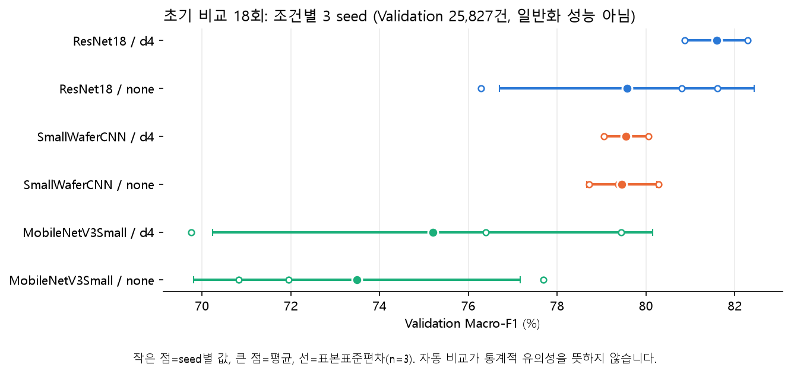
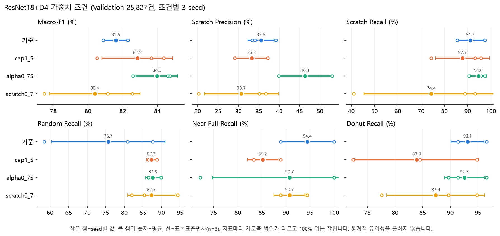
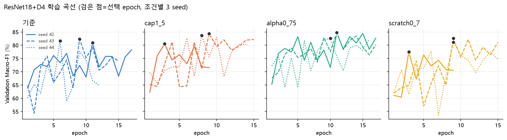
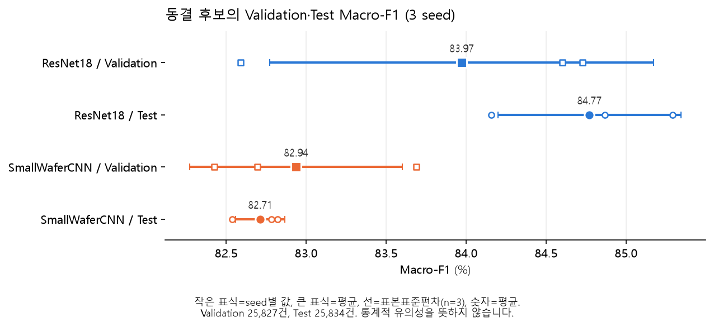
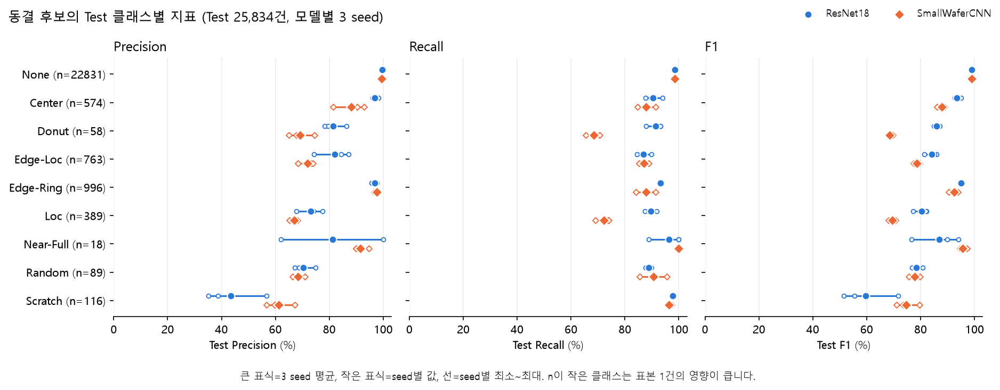
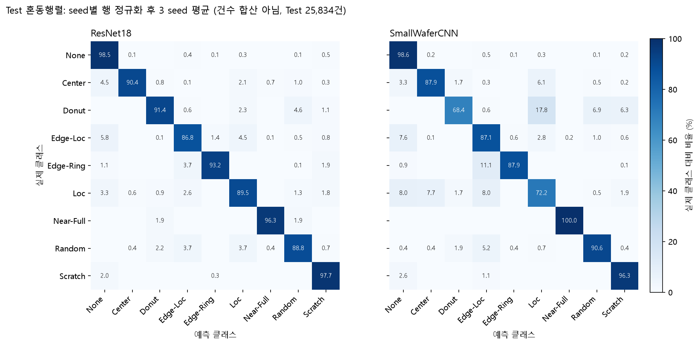

# WM-811K EDA·전처리·모델 실험 보고서

- 작성일: 2026-10-10, 모델 실험·최종 Test 결과 갱신: 2026-11-02
- 함께 볼 파일: [analysis.ipynb](analysis.ipynb)
- 기준: 1~9절은 노트북에 저장된 분할 전 EDA 결과, 10~14절은 저장된 분할·변환·캐시 보고서와 사용자가 공유한 Dataset 검사 출력, 15~21절은 저장된 Validation 실험 결과, 22~23절은 저장된 최종 평가 결과입니다. 노트북을 재실행해도 이 문서의 수치는 자동 갱신되지 않습니다.
- 범위: EDA 해설, 전처리·학습 입력 준비 결과, 모델 튜닝, Validation 기반 사용자 선정·동결, 동결 후보의 최종 Test 결과.

> 1~14절은 2026-10-10의 전처리 실행 기록이며, 현재 실험에서 전처리를 다시 실행했다는 뜻이 아니다. 15절 이후가 모델 실험 결과다. 현재 실행 계약은 [캐시·Dataset 안내](../../docs/WM811K/CACHE_DATASET.md)를 따른다.

**현재 결과 요약**

- 현재 상태는 **Validation으로 선정·동결한 ResNet18 종합후보와 SmallWaferCNN 비교후보의 최종 평가 완료**다. 학습 39회(초기 18 + ResNet18 가중치 9 + CNN 가중치 6 + 학습률 스케줄 6)와 ResNet18+D4 Validation 재추론 3회를 사용자가 로컬 GPU에서 실행했고, 동결 checkpoint 6개를 같은 Test 25,834행으로 각각 평가했다. CNN `scratch0_7` 3회는 미실행이다.
- Test Macro-F1은 ResNet18 **84.77 ± 0.57%**, SmallWaferCNN **82.71 ± 0.15%**다(3 seed). ResNet18은 Donut·Loc Recall이 높고, SmallWaferCNN은 Scratch 오탐이 적고 Random·Near-Full Recall 평균이 높다([22절](#22-최종-test-결과)).
- 두 모델은 학습률 스케줄이 달라 구조만의 비교가 아니라 선정된 튜닝 구성의 비교다. 같은 Test를 seed별로 반복 평가한 값이며 통계적 유의성을 검정하지 않았다. 배포 checkpoint 하나를 새로 고르지 않았고, 운영 배포나 미래·현장 성능 보장을 뜻하지 않는다([23절](#23-종합-결론과-한계)).

## 1. 먼저 이해할 용어

| 용어 | 이 보고서에서의 의미 |
| --- | --- |
| 웨이퍼맵 | 다이의 위치와 상태를 2차원 배열로 나타낸 데이터 |
| 유효 다이 | 웨이퍼 밖 영역을 제외한 정상·불량 다이 |
| 불량 다이 비율 | 불량 다이 수 ÷ 유효 다이 수. 웨이퍼 불량 분류 확률과 다름 |
| `None` 클래스 | 명시적으로 라벨이 부여된 무패턴 클래스. 모든 다이가 정상이라는 뜻은 아님 |
| 미라벨(`unlabeled`) | 정답 클래스가 없는 데이터. `None`으로 간주하면 안 됨 |
| accepted | 현재 변환·품질 규칙을 통과한 상태. 정상 제품이거나 라벨이 정확하다는 보증은 아님 |
| Lot | 생산 묶음을 나타내는 식별 단위. 같은 Lot의 표본은 서로 연관될 수 있음 |
| Pearson | 두 값 사이의 직선적인 관계를 나타내는 상관계수 |
| Spearman | 값의 순위를 기준으로 함께 증가·감소하는 경향을 나타내는 상관계수 |

상관계수는 −1부터 +1 사이입니다. +1에 가까우면 함께 증가하고, −1에 가까우면 반대로 움직입니다. 0 근처는 해당 방법으로 포착되는 관계가 약하다는 뜻이지 모든 관계가 없다는 뜻은 아닙니다. `N/A`는 상수 열·표본 부족 등으로 계산하지 못한 경우입니다.

## 2. 노트북을 읽는 순서

1. **기본 집계:** 라벨·미라벨, 클래스 수, 맵 크기, Lot 집계를 확인합니다.
2. **분포 그래프:** 값이 어디에 몰리고 어떤 극단값이 있는지 확인합니다.
3. **수치 metadata 상관분석:** 크기·다이 개수·불량 비율의 관계를 확인합니다.
4. **클래스별 원본 예시:** 수치만으로 설명하기 어려운 공간 패턴을 확인합니다.
5. **검토 메모:** 관찰 결과를 분할·전처리 준비에 연결합니다.
6. **모델 실험:** 노트북 11절이 저장된 Validation 실험 결과를, 12절이 동결 후보의 최종 Test 결과를 읽어 표와 그래프로 표시합니다.

## 3. 기본 집계: 사용할 수 있는 정답은 얼마나 있나요?

전체 811,457건 중 라벨이 있는 데이터는 172,950건(약 21.3%), 미라벨은 638,507건(약 78.7%)입니다. 현재 집계에서 모두 accepted이며, 이것이 분할·학습 준비 완료를 뜻하지는 않습니다.

| 클래스 | 라벨 표본 수 |
| --- | ---: |
| None | 147,431 |
| Center | 4,294 |
| Donut | 555 |
| Edge-Loc | 5,189 |
| Edge-Ring | 9,680 |
| Loc | 3,593 |
| Near-Full | 149 |
| Random | 866 |
| Scratch | 1,193 |

### 해석

`None`은 라벨 데이터의 약 85.2%입니다. 모든 입력을 `None`으로 예측해도 이 라벨 구성에서는 Accuracy가 약 85.2%가 됩니다. 따라서 높은 Accuracy만 보고 좋은 모델이라고 판단하면 안 됩니다.

Near-Full·Donut처럼 표본이 적은 클래스는 특히 주의해야 합니다. 실제 분할 후 클래스별 표본과 독립 그룹 수를 확인하고, 이후 평가는 클래스별 Recall·Macro F1·혼동행렬을 함께 봐야 합니다.

미라벨 638,507건은 정상으로 바꾸지 않습니다. 초기 지도학습의 정답 데이터와 구분해서 관리합니다.

## 4. 분포 그래프 해설

### 4.1 Accepted labeled samples: 클래스 막대그래프

X축은 클래스, Y축은 라벨 표본 수입니다. Y축은 로그 축이므로 눈에 보이는 높이 차이보다 실제 표본 수 차이가 큽니다. `10³ → 10⁴ → 10⁵`는 각각 10배 증가입니다.

이 그래프는 클래스 불균형을 확인하는 용도입니다. 손실 가중치나 샘플링 같은 대응은 분할 후 Train의 분포를 기준으로 결정해야 합니다.

### 4.2 Label / quality status: 라벨·품질 상태

라벨이 있는 accepted 표본과 미라벨 accepted 표본을 구분합니다. 미라벨 막대가 큰 것은 데이터 변환 실패가 아니라 정답이 없는 표본이 많다는 뜻입니다.

### 4.3 Original map dimensions: 원본 크기

- X축: 맵 너비
- Y축: 맵 높이
- 색: 해당 크기 영역에 모인 표본 수. 밝은 영역일수록 많음

오른쪽 위로 이어지는 분포는 너비와 높이가 대체로 함께 커진다는 뜻입니다. 가장 많은 규격은 높이 32 × 너비 29이며 108,687건입니다. 다른 규격도 많고 드물게 훨씬 큰 맵도 존재합니다.

**전처리에서의 의미:** 입력 크기를 통일해야 하지만, 원본 크기가 서로 다릅니다. 작은 맵을 확대해도 실제 정보가 늘어나지는 않고, 큰 맵을 축소하면 가는 결함이 사라질 수 있습니다. 입력 해상도는 예시와 Train/Validation 결과를 통해 검토해야 합니다.

### 4.4 Aspect ratio: 종횡비

종횡비는 너비 ÷ 높이입니다. 1이면 정사각형, 1보다 크면 가로로 길고, 작으면 세로로 깁니다.

대부분이 1 근처에 몰려 있고 일부 극단값 때문에 축이 약 15까지 늘어납니다. 주된 분포가 왼쪽에 압축되어 보이는 이유입니다.

**전처리에서의 의미:** 정사각형으로 강제 변형하면 긴 맵의 패턴이 왜곡될 수 있습니다. 비율 유지 resize와 padding을 검토할 근거입니다. 극단적인 맵은 원본 형태와 metadata를 확인하되, 이 그래프만 보고 자동 삭제하지 않습니다.

### 4.5 Failed die ratio: 불량 다이 비율

X축은 0~1의 불량 비율이고 Y축은 로그 축의 표본 수입니다. 낮은 불량 비율에 표본이 많이 몰려 있으며 높은 비율의 맵은 상대적으로 적습니다.

이 그래프는 미라벨을 포함한 전체 유효 맵의 분포입니다. 낮은 불량 비율이라고 `None` 또는 정상 제품으로 확정할 수는 없습니다. 적은 불량 다이도 특정 위치에 모이면 결함 패턴일 수 있습니다.

### 4.6 Lot size distribution: Lot별 표본 수

총 46,293개 Lot이 있고, Lot당 표본 수의 중앙값은 24건, 최댓값은 25건입니다. 25건인 Lot에 큰 봉우리가 보입니다.

같은 Lot의 표본은 서로 연관될 수 있으므로 행 단위 무작위 분할보다 Lot 관계를 고려하는 분할이 필요합니다. 그래프만으로 각 Lot의 실제 생산 조건까지 알 수는 없습니다.

## 5. 다이 개수·클래스별 불량 비율

### 5.1 Valid die counts / Failed die counts

두 히스토그램은 각각 유효 다이 수와 불량 다이 수를 보여줍니다. 작은 값에 대부분이 몰리고 일부 큰 값이 긴 꼬리를 만듭니다. Y축도 로그 축입니다.

이것은 대부분의 맵이 상대적으로 작거나 불량 개수가 적다는 뜻입니다. 드문 큰 맵이 축을 늘리므로 왼쪽이 조밀하게 보입니다. 오른쪽의 드문 표본이 곧 오류라는 뜻은 아닙니다.

### 5.2 Ratio by class: 박스플롯

- 주황색 선: 중앙값
- 상자: 가운데 50% 표본의 범위
- 수염: 기본 박스플롯 규칙에 따른 범위. 최솟값·최댓값과 같다고 볼 수 없음
- 극단값 점은 표시하지 않음. 따라서 보이는 범위가 전체 범위는 아님

Near-Full은 불량 비율이 매우 높고 Random도 상대적으로 높습니다. 반면 Edge-Loc·Edge-Ring·Loc·Scratch 등은 불량 비율 구간이 상당히 겹칩니다. None에도 불량 다이가 존재합니다.

**핵심:** 불량 비율만으로 모든 클래스를 구별하기 어렵습니다. 불량 다이가 중앙·가장자리·국소 영역·선 형태 중 어디에 배치되어 있는지가 중요합니다. 이것이 이미지 기반 패턴 학습의 필요성과 연결됩니다.

## 6. 상관분석 해설

### 6.1 분석 대상과 읽는 방법

전체 상관계수는 accepted 유효 맵 중 수치 항목이 모두 관측된 811,457건으로 계산했습니다. 미라벨도 포함합니다. 클래스 번호·Lot·해시·행 번호는 수치 변수에서 제외했습니다.

히트맵은 빨강이 양의 상관, 파랑이 음의 상관입니다. 대각선의 1은 자기 자신과의 관계이므로 새로운 정보가 아닙니다. Pearson과 Spearman의 차이는 분포 쏠림·극단값·직선이 아닌 관계 등의 영향을 함께 살펴볼 계기이지 원인을 확정하는 증거는 아닙니다.

### 6.2 전체 데이터에서 관찰된 관계

| 변수 쌍 | Pearson | Spearman | 해석 |
| --- | ---: | ---: | --- |
| 높이 ↔ 너비 | 0.77 | 0.91 | 맵의 가로·세로가 함께 커지는 경향 |
| 높이 ↔ 유효 다이 수 | 0.94 | 0.97 | 큰 맵에 다이가 많음 |
| 너비 ↔ 유효 다이 수 | 0.87 | 0.97 | 큰 맵에 다이가 많음 |
| 유효 다이 수 ↔ 불량 다이 수 | 0.26 | 0.21 | 다이가 많다고 불량 개수도 강하게 증가하는 것은 아님 |
| 유효 다이 수 ↔ 불량 비율 | −0.23 | −0.43 | 큰 맵에서 불량 비율이 낮은 경향 |
| 불량 다이 수 ↔ 불량 비율 | 0.44 | 0.68 | 불량 개수가 많을수록 비율도 높은 경향 |
| 종횡비 ↔ 불량 비율 | 0.02 | 0.10 | 전체적으로 뚜렷한 직선·단조 관계가 약함 |

계수는 노트북 히트맵의 소수 둘째 자리 표시를 옮긴 값입니다.

불량 비율은 **불량 다이 수 ÷ 유효 다이 수**로 계산됩니다. 따라서 이 세 변수 사이에는 계산식 자체의 연결이 있습니다. 상관을 독립적인 공정 원인이나 인과관계로 해석하면 안 됩니다.

### 6.3 산점도에서 앞쪽에 몰리는 이유

점 하나는 맵 하나입니다. 산점도는 화면 가독성을 위해 최대 5,000건을 고정 시드로 추출했으며 클래스 균형 표본은 아닙니다. 상관계수를 계산한 표본 수와 다릅니다.

| 산점도 | 몰림의 의미 |
| --- | --- |
| 유효 다이 수 ↔ 불량 다이 수 | 왼쪽 아래에 몰리면 다이 수와 불량 개수가 작은 맵이 많다는 뜻 |
| 유효 다이 수 ↔ 불량 비율 | 작은 맵은 비율이 넓게 퍼지고, 큰 맵은 낮은 비율에 많이 모이는 모습 |
| 종횡비 ↔ 불량 비율 | 대부분 비슷한 종횡비를 갖고, 일부 긴 맵 때문에 주된 점들이 압축됨 |

예를 들어 불량 다이가 20개라도 유효 다이 100개 중 20개면 20%, 1,000개 중 20개면 2%입니다. 불량 **개수**와 **비율**을 구분해서 봐야 합니다.

왼쪽에 몰렸다는 사실만으로 정규화·제거·로그 변환을 결정하지 않습니다. 필요하면 표시 범위를 확대한 보조 그래프를 사용하되 전체 범위도 함께 보존해야 합니다.

### 6.4 클래스별 관계가 같은가요?

아래는 유효 다이 수와 불량 비율의 관계입니다. 전체 상관과 달리 클래스별 표는 라벨이 있는 accepted 표본으로 계산했습니다.

| 클래스 | 표본 수 | Pearson | Spearman |
| --- | ---: | ---: | ---: |
| None | 147,431 | −0.445 | −0.704 |
| Center | 4,294 | −0.389 | −0.596 |
| Donut | 555 | 0.224 | 0.127 |
| Edge-Loc | 5,189 | −0.279 | −0.518 |
| Edge-Ring | 9,680 | −0.631 | −0.770 |
| Loc | 3,593 | −0.331 | −0.571 |
| Near-Full | 149 | −0.016 | −0.073 |
| Random | 866 | −0.200 | −0.089 |
| Scratch | 1,193 | −0.471 | −0.728 |

Edge-Ring·Scratch 등에서는 음의 순위 관계가 뚜렷하지만 Near-Full·Random·Donut에서는 약합니다. 전체 데이터의 관계를 모든 클래스에 동일하게 적용할 수 없다는 뜻입니다.

가장자리나 선 형태의 결함은 맵 크기에 따라 차지하는 비율이 달라질 가능성이 있지만, 이 표로 그 원인을 증명한 것은 아닙니다. 표본 수·맵 규격·중복·Lot 구성·비율의 계산식 영향을 고려해야 합니다. 유의성 검정도 수행하지 않았습니다.

## 7. 클래스별 원본 맵 예시

회색은 웨이퍼 밖(0), 초록은 정상 다이(1), 빨강은 불량 다이(2)입니다.

| 클래스 | 현재 예시에서 확인할 부분 |
| --- | --- |
| None | 불량 다이가 있어도 특정 패턴으로 명확하게 모이지 않는 모습 |
| Center | 중앙 부근의 불량 집중 |
| Donut | 중앙 주변의 고리 형태 분포 |
| Edge-Loc | 가장자리 일부 영역의 불량 집중 |
| Edge-Ring | 가장자리를 따라 이어지는 띠 |
| Loc | 국소 영역의 군집 |
| Near-Full | 거의 전체를 차지하는 불량 다이 |
| Random | 넓은 영역에 흩어진 불량 |
| Scratch | 선 형태로 이어지는 불량 |

각 클래스의 첫 accepted 1건만 표시했습니다. 대표 표본을 선정한 결과가 아니며, 모든 데이터가 예시처럼 명확한 패턴을 가진다는 보장은 없습니다.

**전처리에서의 의미:** 다이 값 0·1·2는 서로 다른 상태입니다. 이미지 변환 중 이를 무분별하게 섞거나, 축소 과정에서 가는 선과 가장자리 패턴을 지우지 않도록 입력 인코딩·보간·padding 방식을 검토해야 합니다.

## 8. 중복·라벨 충돌과 분할

| 항목 | 현재 집계 |
| --- | ---: |
| 동일 맵 중복 그룹 | 32,630 |
| 중복 그룹에 속한 전체 행 | 147,488 |
| 동일 맵의 명시적 라벨 충돌 그룹 | 14 |

147,488건은 삭제할 중복 건수가 아닙니다. 반복 등장한 맵 그룹에 속한 **전체 행 수**입니다. 같은 맵이라는 사실만으로 동일한 생산 웨이퍼의 복제라고 단정할 수도 없습니다.

같은 맵이나 연관된 Lot이 Train과 평가 데이터에 걸쳐 들어가면 평가가 쉬워질 수 있습니다. 따라서 Lot·동일 맵 연결 그룹을 고려하는 분할 설계가 필요합니다.

이 절의 EDA는 충돌 그룹 제외 전 데이터입니다. 파일 정합성 통과는 라벨 충돌 해소나 분할 완료를 뜻하지 않습니다. 이후 수행한 실제 제외·분할 결과는 10~11절에 구분해 기록합니다.

## 9. 전처리 준비에 연결할 결론

| 관찰 | 필요한 대처 |
| --- | --- |
| 미라벨이 대부분 | 지도학습 라벨 데이터와 분리 관리. 미라벨을 정상으로 변환하지 않음 |
| 클래스 불균형이 큼 | 그룹 분할 후 클래스별 지원 수 확인. Train 기반 가중치·샘플링 검토 |
| 맵 크기와 종횡비가 다양 | 비율 유지 resize·padding 및 입력 해상도 검토 |
| 불량 비율이 클래스 간 겹침 | 개수만이 아니라 공간 패턴을 학습하도록 원본 배치 보존 |
| 큰 맵·극단적 종횡비 존재 | 원본 형태·변환 규칙 확인. 근거 없는 자동 삭제 금지 |
| 중복·라벨 충돌 존재 | 충돌 처리 정책 확정 후 Lot·동일 맵 연결 그룹 분할 |

분할 전 전체 EDA는 구조와 품질 확인용입니다. 모델 성능에 맞춘 변환 설정·학습 통계·특징 선택은 분할 후 Train/Validation에서 수행하고 Test 결과로 재조정하지 않습니다.

에이전트가 EDA를 실행할 때도 분석과 상세 결과는 로컬 도구 안에서 처리합니다. 실제 맵·집계·그래프·식별자·경로를 외부 LLM이나 추적 서비스로 전달하지 않는 보안 설계는 유지합니다.

**요약:** 현재 데이터는 크기·클래스 구성·중복 측면에서 주의가 필요합니다. 딥러닝 전처리의 핵심은 불량의 공간 패턴을 보존하면서 입력 크기를 통일하고, 연관된 표본이 평가 구간으로 새지 않도록 그룹 분할하는 것입니다.

## 10. 실제 전처리 실행과 데이터 수 변화

확인일은 2026-10-10입니다. 저장된 요약 보고서를 읽어 정리했으며 원본 pickle 재읽기·캐시 재생성·모델 학습은 수행하지 않았습니다.

| 단계 | 전체 행 | 명시적 라벨 행 | 미라벨 행 | 의미 |
| --- | ---: | ---: | ---: | --- |
| 라벨 별칭 보완 후 canonical | 811,457 | 172,950 | 638,507 | 분할 전 EDA 기준 |
| 충돌 그룹 제외 | 33 | 28 | 5 | 동일 맵의 명시적 라벨 충돌 14그룹 전체를 분할 대상에서 제외 |
| 제외 후 대상 | 811,424 | 172,922 | 638,502 | 미라벨은 지도학습 입력에서 별도 제외 |
| Train·Validation 입력 캐시 | 147,088 | 147,088 | 0 | Test는 아직 캐시로 준비하지 않음 |

이전 export에서 `Near-full` 표기를 인식하지 못해 149건을 격리했던 문제는 라벨 별칭 보완 후 해결했습니다. 현재 canonical의 `Near-Full`은 149건입니다. 과거 실패 집계를 최종 정제 결과와 혼용하지 않습니다.

33건은 원본 파일을 삭제하거나 라벨을 임의로 바꾼 것이 아닙니다. 파생 분할 manifest에 격리 상태와 사유를 남겼습니다. 또한 EDA의 중복 그룹 소속 147,488건 전체를 삭제한 것이 아닙니다. 라벨 충돌이 없는 동일 맵은 연결 그룹 안에서 함께 관리합니다.

## 11. 그룹 분할 결과와 보호 범위

목표 비율은 Train/Validation/Test 약 70/15/15입니다. 같은 Lot과 동일 맵으로 연결된 그룹을 분할 단위로 삼아 정확한 비율보다 그룹 비중첩을 우선했습니다. 설정 seed는 42이며 최대 32개 후보에서 전체·클래스별 표본 비율의 제곱편차 합이 가장 작은 후보를 선택했습니다. 목적함수의 기호와 해석은 [그룹 분할 문서](../../docs/WM811K/GROUP_SPLIT.md#후보-균형-점수)를 참고합니다. 모델 성능으로 분할 후보를 고른 것은 아닙니다.

| 클래스 | Train | Validation | Test |
| --- | ---: | ---: | ---: |
| None | 101,768 | 22,821 | 22,831 |
| Center | 3,144 | 573 | 574 |
| Donut | 439 | 58 | 58 |
| Edge-Loc | 3,653 | 764 | 763 |
| Edge-Ring | 7,685 | 997 | 996 |
| Loc | 2,811 | 390 | 389 |
| Near-Full | 113 | 18 | 18 |
| Random | 688 | 89 | 89 |
| Scratch | 960 | 117 | 116 |
| **합계** | **121,261** | **25,827** | **25,834** |
| **전체 라벨 대상 대비 비율** | **70.12%** | **14.94%** | **14.94%** |

`split_summary.csv`는 위 집계의 요약이며 실제 행의 소속은 `split_manifest.jsonl`에 기록됩니다.

- `split_group_id`: 연결된 표본 그룹의 식별자.
- `group_split`: 그룹의 배정 구간. 지도학습 라벨이 없는 일부 그룹은 미배정일 수 있음.
- `split`: 행의 최종 용도. train·validation·test와 unlabeled·quarantined를 구분.

저장 보고서는 `overlap_check_passed=true`, `source_modified=false`입니다. 승인된 Lot·동일 맵 그룹 비중첩 검사를 통과했으며 원본을 변경하지 않았습니다. 이것이 모든 가능한 공정 상관관계나 유사 맵까지 차단했다는 보장은 아닙니다.

분할 프로토콜은 다음과 같습니다. 변환·캐시·Dataset 결과를 연결하는 식별값이지 별도의 성능 점수가 아닙니다.

```text
wm_split_d02d993fd73c2cc4bf496d54774401c60a94b0d1737c7c135e7ae4837a6b85d6
```

Near-Full의 평가 표본은 구간별 18건뿐입니다. 추후 클래스별 Recall은 소수 표본에 크게 흔들릴 수 있으므로 표본 수와 함께 해석해야 합니다. 전체 EDA에 분할 전 모든 표본의 구조·집계를 사용한 이력은 보존하며, Test 정보를 전혀 접하지 않았다고 표현하지 않습니다. 현재 실험에서는 Test 성능 평가를 수행하지 않았습니다. Test 사용 이력은 [19절](#23-종합-결론과-한계)을 따릅니다.

## 12. 입력 변환 방법과 패턴 보존 검사

| 항목 | 실제 적용 |
| --- | --- |
| 목표 크기 | 128×128 |
| 크기 변환 | 비율 유지, `numpy_half_pixel_nearest_v1` 좌표 규칙 |
| 여백 | 중앙 padding, 상태 값 0. 홀수 추가 여백은 아래·오른쪽 |
| 캐시 | 원본의 외부·정상·불량 상태를 유지한 uint8 맵 |
| 모델 입력 | 채널 0=`map==2` 불량 마스크, 채널 1=`map>0` 유효 다이 마스크 |
| 입력 자료형 | float32, 두 채널 값은 0 또는 1 |
| 라벨 | 고정 9클래스 정수 0~8, int64 |
| 증강·추가 정규화 | 캐시와 Validation에는 없음. D4는 모델 비교의 `d4` 조건에서 Train 읽기에만 적용([15절](#15-현재-모델-실험의-범위와-근거)) |

픽셀 값 0·1·2를 연속 밝기로 보간하지 않고 범주로 유지합니다. 2채널 마스크는 외부 영역과 정상 다이를 구분하며, sample_id·Lot·라벨을 이미지 입력에 섞지 않습니다.

Train·Validation 147,088건의 변환 검사 결과는 `transform_check_passed`입니다. 불량 영역 전체 소실 0건, 유효 영역 전체 소실 0건이며 Test 배열은 검사하지 않았습니다.

| 구간 | 검사 행 | 불량 영역 전체 소실 | 유효 영역 전체 소실 | 불량 다이 비율 최대 절대 변화 |
| --- | ---: | ---: | ---: | ---: |
| Train | 121,261 | 0 | 0 | 약 1.623%p |
| Validation | 25,827 | 0 | 0 | 약 1.004%p |

비율 차이 0.01은 1%가 아니라 **1%p의 절대 차이**입니다. 전체 소실이 없다고 가는 Scratch 선·고리·국소 결함의 모든 형태가 동일하게 보존된 것은 아닙니다. 자동 검사는 형태 동등성이나 최적 해상도를 증명하지 않으며, 선택 사례의 원본·변환 그림을 사용자가 시각 확인했습니다.


상세 클래스별 변화량은 [변환 검사 보고서](transform_v1/transform_check.md)와 노트북 8절에서 확인합니다. 그림의 사례는 전체 표본의 대표성을 보장하지 않습니다.

## 13. 캐시·Dataset 검증 결과

| 구간 | 캐시 표본 수 | NPY shard 수 | 첫 배치 상태 |
| --- | ---: | ---: | --- |
| Train | 121,261 | 30 | `dataset_batch_passed` |
| Validation | 25,827 | 7 | `dataset_batch_passed` |
| Test | 분할 25,834건 | 현재 실험 캐시에 없음 | 현재 실험에서 미사용 |

캐시 생성 완료 상태는 `cache_complete`이며 선택한 파일과 색인의 해시·개수·분할 연결을 기록합니다. 원본 전체를 RAM에 올리는 방식이 아니라 bounded buffer로 저장하고 Dataset은 읽기 전용 mmap으로 필요한 파일을 읽습니다.

사용자가 공유한 Train·Validation 첫 배치 결과는 모두 이미지 `[32,2,128,128]`, `torch.float32`, 라벨 `torch.int64`입니다. 합성 데이터 기반 회귀 검사와 실제 GPU 실행·첫 배치 결과는 서로 다른 근거입니다.

캐시의 `training_ready=false`는 첫 배치 CLI 실행 후에도 자동 변경하지 않습니다. 이 절의 확인 범위는 선택 구간 파일 정합성과 첫 배치 계약입니다. 이후 전체 Epoch 학습은 15~18절의 실험으로 실행했지만, 다중 worker 처리량과 학습 시 RAM은 측정하지 않았습니다.

캐시의 클래스 가중치 후보는 Train 빈도만으로 계산한 기록입니다. 학습에 적용한 값은 학습 설정이 정하며 [18절](#18-resnet18d4-가중치-후보-9회)에 있습니다. Validation/Test를 균형화하지 않았습니다.

## 14. 데이터 전달 및 사용 방법

- 코드·설정·의존성·실행 방법은 Git으로 전달합니다. 상세 명령은 [캐시·Dataset 사용법](../../docs/WM811K/CACHE_DATASET.md)을 따릅니다.
- 데이터는 Git으로 전달하지 않습니다. 캐시 폴더 전체의 `cache.json`, `cache.md`, `SUCCESS.json`, train·validation의 NPY와 `index.jsonl`을 별도 전달합니다. 맵 파일만 복사하면 Dataset 계약이 충족되지 않습니다.
- 데이터를 받은 환경에서 Train·Validation 첫 배치 명령을 다시 실행합니다. Dataset은 고정된 split을 읽으므로 다시 무작위 분할하지 않습니다.
- Test를 모델 선택이나 전처리 조정에 쓰지 않습니다. Test 결과를 본 뒤 전처리·모델·문턱을 반복 조절하지 않으며, 향후 Test 사용·실패·변경 이력은 별도로 기록합니다.
- 상세 맵·표본 색인·실제 집계·그래프·경로를 향후 에이전트의 외부 LLM·추적 서비스에 자동 전송하지 않습니다. Git 공개 여부는 별도 검토이며 LLM 입력 허용과 같지 않습니다.

## 15. 현재 모델 실험의 범위와 근거

아래 수치는 사용자가 로컬 GPU(CUDA)에서 실행한 학습·재추론·최종 평가의 저장 결과입니다. 자동 테스트의 합성 통과와는 다른 근거입니다. 노트북 [11·12절](analysis.ipynb)은 같은 저장 결과를 읽어 표시합니다.

| 항목 | 값 |
| --- | --- |
| 초기 비교 | `SmallWaferCNN`, `ResNet18`, `MobileNetV3Small` × `none`, `d4` × seed 42·43·44 = 18회 |
| ResNet18 가중치 후보 | ResNet18+D4 × `cap1_5`, `alpha0_75`, `scratch0_7` × 같은 seed 3개 = 9회 |
| CNN 가중치 후보 | SmallWaferCNN+D4 × `cap1_5`, `alpha0_75` × 같은 seed 3개 = 6회. `scratch0_7` 3회는 미실행 |
| 학습률 스케줄 | ResNet18·SmallWaferCNN의 `alpha0_75` + `ReduceLROnPlateau` × 같은 seed 3개 = 6회 |
| 학습 합계 | 39회(완료 표식·학습 보고서 39건 확인). Validation 재추론 3회와 Test 평가 6회는 학습이 아니므로 합산하지 않음. 파일럿(`compare_pilot`)·`cnn_v1_table_probe`는 비교 근거에서 제외 |
| 데이터 | Train 121,261건, Validation 25,827건, Test 25,834건, 9클래스. 분할 프로토콜은 11절과 같음 |
| 입력 | 2채널(불량·유효 마스크) 128×128 |
| 초기화 | 세 모델 모두 무작위 초기화. 사전학습 가중치 없음 |
| 학습 설정 | AdamW, 초기 learning rate 0.001, weight decay 0.0001, batch 64, 최대 30 epoch, patience 6. 스케줄 6회만 학습률 감소 적용 |
| 손실 | Train 빈도 기반 class-weighted Cross Entropy |
| 선택 기준 | Validation Macro-F1 최고 epoch. 39회 모두 epoch 상한 전에 조기 종료 |
| D4 | 90도 회전·반전을 Train 읽기 시점에만 적용. 캐시·Validation·재추론·Test에는 미적용 |
| Test | 학습 39회와 재추론 모두 미사용. 동결 뒤 별도 최종 평가([22절](#22-최종-test-결과)) |

MLP 계열은 이번 비교에 포함하지 않았습니다. 성능을 비교해 제외한 것이 아닙니다.

평균은 3 seed 평균, ±는 표본표준편차(n=3)입니다. seed 3개의 변동을 보여 줄 뿐 신뢰구간이나 통계적 유의성이 아닙니다. Near-Full은 Validation·Test 각 18건, Donut은 각 58건이어서 1건이 각각 약 5.6%p, 1.7%p를 움직입니다.

원본 위치는 다음과 같습니다. `reports/wm811k/results/`의 CSV와 `models/`는 Git에서 제외되므로 실행 환경에서만 확인할 수 있습니다.

- 초기 비교: [compare_v2/comparison.md](results/compare_v2/comparison.md), `results/compare_v2/summary.csv`, `runs.csv`, `models/wm811k/compare_v2/`
- 재추론: [resnet18_d4_v1/report.md](validation_errors/resnet18_d4_v1/report.md)
- ResNet18 가중치 후보: [cap1_5](results/weight_v1/cap1_5_vs_baseline/comparison.md), [alpha0_75](results/weight_v1/alpha0_75_vs_baseline/comparison.md), [scratch0_7](results/weight_v1/scratch0_7_vs_baseline/comparison.md), `models/wm811k/weight_v1/`
- CNN 가중치·학습률 스케줄·동결·최종 평가의 원본은 19~22절 끝에 있습니다.

## 16. 초기 비교 18회

Macro-F1 평균 순서입니다. 우열 판정이나 통계적 유의성을 뜻하지 않습니다.

| 모델 | 증강 | Macro-F1 (%) | seed별 범위 (%) | Scratch Precision (%) | Scratch Recall (%) | Random Recall (%) | Near-Full Recall (%) | Donut Recall (%) |
| --- | --- | ---: | ---: | ---: | ---: | ---: | ---: | ---: |
| ResNet18 | d4 | 81.60 ± 0.71 | 80.88~82.29 | 35.53 ± 3.21 | 91.17 ± 6.00 | 75.66 ± 15.30 | 94.44 ± 5.56 | 93.10 ± 2.99 |
| ResNet18 | none | 79.57 ± 2.87 | 76.29~81.62 | 30.27 ± 9.49 | 90.31 ± 6.42 | 81.27 ± 2.83 | 100.00 ± 0.00 | 77.01 ± 10.53 |
| SmallWaferCNN | d4 | 79.55 ± 0.50 | 79.05~80.06 | 39.42 ± 4.00 | 96.30 ± 0.99 | 89.89 ± 1.12 | 94.44 ± 5.56 | 85.06 ± 5.54 |
| SmallWaferCNN | none | 79.46 ± 0.79 | 78.72~80.28 | 54.58 ± 13.03 | 95.16 ± 4.30 | 91.76 ± 3.61 | 96.30 ± 3.21 | 72.99 ± 14.04 |
| MobileNetV3Small | d4 | 75.20 ± 4.95 | 69.76~79.45 | 26.49 ± 12.00 | 85.19 ± 5.49 | 81.65 ± 12.38 | 96.30 ± 3.21 | 89.08 ± 10.53 |
| MobileNetV3Small | none | 73.49 ± 3.68 | 70.83~77.68 | 12.43 ± 5.01 | 85.75 ± 6.91 | 82.77 ± 11.37 | 90.74 ± 8.49 | 81.03 ± 6.22 |



- **계열 비교:** 평균 Macro-F1은 ResNet18+D4가 가장 높았고 MobileNetV3Small은 두 조건 모두 낮았습니다. SmallWaferCNN은 평균이 ResNet18보다 낮아도 Scratch·Random 지표가 더 높은 조건이 있어 Macro-F1 하나로 대체할 수 없습니다.
- **D4 효과:** 평균 Macro-F1은 세 모델 모두 `d4`가 높지만 차이는 ResNet18 +2.03%p, SmallWaferCNN +0.09%p, MobileNetV3Small +1.71%p로 표준편차를 고려하면 작습니다. 가장 뚜렷한 평균 변화는 Donut Recall(+8.05~+16.09%p)이며, SmallWaferCNN Scratch Precision은 `d4`에서 15.16%p 낮았습니다.
- **seed 변동:** MobileNetV3Small+D4는 seed별 범위가 약 9.7%p로 커서 평균만으로 읽으면 안 됩니다. ResNet18+D4의 Random Recall도 ±15.30%p로 흔들렸습니다.

| 모델 | 증강 | 파라미터 | 평균 실행 epoch | 학습 시간(분) | 학습 메모리(MiB) | 추론(ms/표본) | 추론 메모리(MiB) |
| --- | --- | ---: | ---: | ---: | ---: | ---: | ---: |
| ResNet18 | d4 | 11,177,993 | 14.7 | 34.2 ± 3.5 | 691 | 0.062 | 315 |
| ResNet18 | none | 11,177,993 | 14.0 | 29.3 ± 9.2 | 691 | 0.057 | 315 |
| SmallWaferCNN | d4 | 288,329 | 25.7 | 52.6 ± 7.2 | 858 | 0.056 | 401 |
| SmallWaferCNN | none | 288,329 | 24.7 | 49.3 ± 3.7 | 858 | 0.065 | 401 |
| MobileNetV3Small | d4 | 1,526,937 | 15.7 | 40.2 ± 13.1 | 420 | 0.069 | 190 |
| MobileNetV3Small | none | 1,526,937 | 17.3 | 40.6 ± 19.3 | 420 | 0.069 | 190 |

파라미터 수가 곧 시간이나 메모리를 뜻하지 않습니다. 이번 측정에서 파라미터가 가장 적은 SmallWaferCNN의 학습 메모리·학습 시간이 가장 컸습니다. 학습 시간은 조기 종료 epoch에 좌우되고, 추론 시간은 batch 64의 표본 640개를 3회 측정한 값이라 차이를 일반화하지 않습니다. 이후 ResNet18+D4를 재추론과 가중치 실험의 기준으로 사용했습니다. 이것은 다음 분석의 출발점이었으며 후보 동결은 [21절](#21-validation-기반-사용자-선정과-동결)에서 별도로 했습니다.

## 17. ResNet18+D4 Validation 재추론과 오분류

세 seed checkpoint로 Validation만 재추론했고, 세 seed 모두 저장된 selected epoch 혼동행렬과 재현 일치했습니다. 분석에서 재학습·앙상블·Test는 없었습니다.

| 오류 흐름 | 실제 표본 | 서로 다른 오류 표본 | 전 seed 공통 | seed42·43·44 예측 건수 |
| --- | ---: | ---: | ---: | ---: |
| Loc → Scratch | 390 | 73 | 7 | 21·23·60 |
| None → Scratch | 22,821 | 299 | 24 | 175·111·133 |
| Random → 다른 클래스 | 89 | 37 | 10 | 11·17·37 |

`서로 다른 오류 표본`은 고유 표본 수이고, seed별 건수는 같은 표본이 다시 틀릴 수 있는 반복 예측 횟수입니다. 합산해 독립 표본처럼 읽지 않습니다. 전체로는 한 seed 이상에서 틀린 표본 1,285개, 세 seed 모두 틀린 표본 259개입니다.

Scratch 오탐의 큰 출처는 `None`과 `Loc`이었고, 이 결과가 가중치 후보를 시험한 배경입니다. 오류의 원인이 가중치라고 확인한 것은 아닙니다.

이미지는 그룹별 24개씩 총 72개의 **선정 표본**이며 전체 오류가 아닙니다. 선정 기준은 오류 seed 수 내림차순, 동률은 `sample_id` 오름차순이고, 생략 표본은 Loc→Scratch 49개, None→Scratch 275개, Random→다른 클래스 13개입니다. 범례는 Outside wafer `#EFEFEF`, Valid die `#4C78A8`, Defect die `#F58518`입니다. 모델 입력을 3색으로 합성한 검사 맵이며 광학 사진이 아닙니다.

- [Loc → Scratch 1쪽](validation_errors/resnet18_d4_v1/images/loc_to_scratch_page01.png), [2쪽](validation_errors/resnet18_d4_v1/images/loc_to_scratch_page02.png)
- [None → Scratch 1쪽](validation_errors/resnet18_d4_v1/images/none_to_scratch_page01.png), [2쪽](validation_errors/resnet18_d4_v1/images/none_to_scratch_page02.png)
- [Random → 다른 클래스 1쪽](validation_errors/resnet18_d4_v1/images/random_to_other_page01.png), [2쪽](validation_errors/resnet18_d4_v1/images/random_to_other_page02.png)

`None`은 데이터셋 라벨이며 미라벨이나 최종 양품 판정이 아닙니다. 이미지 관찰만으로 라벨 오류나 물리 원인을 확정하지 않고, 예측을 근거로 라벨을 수정하지 않습니다.

## 18. ResNet18+D4 가중치 후보 9회

세 후보는 앞 후보를 누적하지 않고 기준에서 하나씩 독립적으로 바꾼 조건입니다. 공통 배율은 가중 평균 손실에서 상쇄되므로 클래스 사이 비율로 읽습니다.

| 조건 | 상한 | alpha | Scratch 계수 | Scratch/None 비 | Near-Full/Scratch 비 |
| --- | ---: | ---: | ---: | ---: | ---: |
| 기준 | 10 | 1 | 1 | 106.01 | 8.50 |
| `cap1_5` | 1.5 | 1 | 1 | 55.34 | 1.00 |
| `alpha0_75` | 10 | 0.75 | 1 | 33.04 | 4.98 |
| `scratch0_7` | 10 | 1 | 0.7 | 74.21 | 12.14 |

| 지표 (%) | 기준 | `cap1_5` | `alpha0_75` | `scratch0_7` |
| --- | ---: | ---: | ---: | ---: |
| Macro-F1 | 81.60 ± 0.71 | 82.84 ± 2.04 | 83.97 ± 1.20 | 80.39 ± 2.62 |
| Scratch Precision | 35.53 ± 3.21 | 33.28 ± 4.06 | 46.32 ± 6.57 | 30.70 ± 9.08 |
| Scratch Recall | 91.17 ± 6.00 | 87.75 ± 11.67 | 94.59 ± 3.56 | 74.36 ± 28.95 |
| Random Recall | 75.66 ± 15.30 | 87.27 ± 1.30 | 87.64 ± 1.95 | 87.27 ± 6.39 |
| Near-Full Recall | 94.44 ± 5.56 | 85.19 ± 3.21 | 90.74 ± 16.04 | 90.74 ± 3.21 |
| Donut Recall | 93.10 ± 2.99 | 83.91 ± 11.22 | 92.53 ± 3.59 | 87.36 ± 8.85 |

| 3 seed 평균 건수 (3 seed 합계 순증) | 기준 | `cap1_5` | `alpha0_75` | `scratch0_7` |
| --- | ---: | ---: | ---: | ---: |
| Scratch FP | 196.00 | 206.00 (+30) | 132.33 (−191) | 189.67 (−19) |
| Scratch FN | 10.33 | 14.33 (+12) | 6.33 (−12) | 30.00 (+59) |
| Random FN | 21.67 | 11.33 (−31) | 11.00 (−32) | 11.33 (−31) |
| Near-Full FN | 1.00 | 2.67 (+5) | 1.67 (+2) | 1.67 (+2) |
| Donut FN | 4.00 | 9.33 (+16) | 4.33 (+1) | 7.33 (+10) |

| 같은 seed 기준 대비 차이 (%p) | seed | `cap1_5` | `alpha0_75` | `scratch0_7` |
| --- | ---: | ---: | ---: | ---: |
| Macro-F1 | 42 | −0.35 | +3.72 | −3.40 |
| Macro-F1 | 43 | +2.06 | +2.44 | +0.26 |
| Macro-F1 | 44 | +2.02 | +0.96 | −0.49 |
| Scratch Precision | 42 | −4.93 | +12.06 | −13.78 |
| Scratch Precision | 43 | −2.01 | +0.64 | −4.08 |
| Scratch Precision | 44 | +0.20 | +19.67 | +3.37 |

| 비용 | 기준 | `cap1_5` | `alpha0_75` | `scratch0_7` |
| --- | ---: | ---: | ---: | ---: |
| 학습 시간(분) | 34.2 ± 3.5 | 28.4 ± 7.7 | 37.4 ± 1.2 | 28.8 ± 7.8 |
| 선택 epoch (seed42·43·44) | 11·9·6 | 3·9·8 | 11·11·10 | 3·9·9 |
| 학습 메모리(MiB) | 691 | 691 | 691 | 691 |
| 추론(ms/표본) | 0.062 | 0.061 | 0.060 | 0.063 |
| 추론 메모리(MiB) | 315 | 315 | 315 | 315 |





- **`alpha0_75`:** 평균 Macro-F1이 +2.37%p, Scratch Precision이 +10.79%p이고 Macro-F1·Scratch Precision은 세 seed 모두 기준 이상입니다. 다만 Scratch Precision 개선은 seed43에서 +0.64%p에 그쳤고 Scratch FP는 그 seed에서 17건 늘었습니다. Near-Full은 seed43에서 FN이 3건 늘어 표준편차가 16.04%p로 커졌습니다.
- **`cap1_5`:** Macro-F1 평균은 올랐지만 Scratch Precision·Recall과 Near-Full·Donut Recall의 평균이 낮아졌습니다.
- **`scratch0_7`:** Scratch 가중치만 낮췄으나 Scratch Precision이 오히려 평균 4.83%p 낮아졌고, Recall은 seed별 편차가 ±28.95%p로 컸습니다.
- 곡선은 세 후보 모두 epoch 사이 변동이 크므로 선택 epoch 값 하나에 과하게 의존하지 않아야 합니다. 가중치가 달라 조건 사이의 Train loss는 비교하지 않았습니다.

판정 참고안 7개 항목의 대조 결과입니다. 참고안은 사용자가 승인한 운영 기준이나 통계적 유의성 판정이 아닙니다. FN 증가 합계는 후보 3 seed 합에서 기준 3 seed 합을 뺀 값이며, 같은 Validation의 반복 예측이라 독립 표본 수가 아닙니다.

| 조건 | 통과 | 미달 항목 |
| --- | ---: | --- |
| `cap1_5` | 2/7 | Scratch Precision 평균 차이, 개선 seed 수, Scratch Recall 평균 차이, Near-Full FN(+5, 허용 1), Donut FN(+16, 허용 3) |
| `alpha0_75` | 6/7 | Near-Full FN(+2, 허용 1) |
| `scratch0_7` | 1/7 | Macro-F1 평균 차이, Scratch Precision 평균 차이, 개선 seed 수, Scratch Recall 평균 차이, Near-Full FN(+2, 허용 1), Donut FN(+10, 허용 3) |

세 후보 모두 참고안 전체를 통과하지 못했습니다.

**코드 차이:** 기준(`compare_v2`)과 후보(`weight_v1`)의 실행 코드 식별값은 `026d52b6…`, `1aaf425f…`로 서로 다르며 차이 파일은 `train.py`입니다. 기본값에서 가중치 계산이 같다는 것은 합성 비교로 확인한 코드 수준의 근거이고, 실제 신구 코드 학습의 동등성은 측정하지 않았습니다. 세 후보끼리는 같은 코드입니다.

## 19. SmallWaferCNN+D4 가중치 후보 6회

기준은 초기 비교의 `SmallWaferCNN_d4_seed42·43·44`이고, 두 후보는 18절과 같은 설정을 기준에서 하나씩 독립적으로 바꾼 조건입니다. **`scratch0_7` 3회는 실행하지 않았으므로** 이 모델의 Scratch 계수 효과는 알 수 없습니다. ResNet18의 절대 수치를 CNN의 기준으로 쓰지 않습니다. Validation 25,827건의 결과이며 Test는 쓰지 않았습니다.

| 지표 (%) | 기준 | `cap1_5` | `alpha0_75` |
| --- | ---: | ---: | ---: |
| Macro-F1 | 79.55 ± 0.50 | 82.28 ± 2.15 | 83.08 ± 0.93 |
| Accuracy | 95.78 ± 0.36 | 96.58 ± 0.12 | 96.99 ± 0.23 |
| Scratch Precision | 39.42 ± 4.00 | 53.24 ± 5.95 | 61.02 ± 4.94 |
| Scratch Recall | 96.30 ± 0.99 | 91.74 ± 5.69 | 90.03 ± 3.56 |
| Random Recall | 89.89 ± 1.12 | 87.27 ± 2.83 | 91.01 ± 1.12 |
| Near-Full Recall | 94.44 ± 5.56 | 92.59 ± 3.21 | 92.59 ± 8.49 |
| Donut Recall | 85.06 ± 5.54 | 72.41 ± 3.45 | 81.03 ± 4.56 |
| Loc Recall | 70.43 ± 5.29 | 72.65 ± 8.93 | 70.00 ± 5.77 |

| 3 seed 평균 건수 (3 seed 합계 순증) | 기준 | `cap1_5` | `alpha0_75` |
| --- | ---: | ---: | ---: |
| Scratch FP | 175.33 | 95.67 (−239) | 68.00 (−322) |
| Scratch FN | 4.33 | 9.67 (+16) | 11.67 (+22) |
| Random FN | 9.00 | 11.33 (+7) | 8.00 (−3) |
| Near-Full FN | 1.00 | 1.33 (+1) | 1.33 (+1) |
| Donut FN | 8.67 | 16.00 (+22) | 11.00 (+7) |

| 같은 seed 기준 대비 차이 (%p) | seed | `cap1_5` | `alpha0_75` |
| --- | ---: | ---: | ---: |
| Macro-F1 | 42 | −0.17 | +2.62 |
| Macro-F1 | 43 | +3.40 | +4.62 |
| Macro-F1 | 44 | +4.98 | +3.38 |
| Scratch Precision | 42 | +3.20 | +11.91 |
| Scratch Precision | 43 | +18.66 | +24.71 |
| Scratch Precision | 44 | +19.62 | +28.18 |

| 조건 | 통과 | 미달 항목 |
| --- | ---: | --- |
| `cap1_5` | 5/7 | Scratch Recall 평균 차이, Donut FN(+22, 허용 3) |
| `alpha0_75` | 5/7 | Scratch Recall 평균 차이, Donut FN(+7, 허용 3) |

- **`alpha0_75`:** 평균 Macro-F1 +3.54%p, Scratch Precision +21.60%p로 세 seed 모두 올랐습니다. 대신 Scratch Recall이 평균 −6.27%p로 세 seed 모두 낮아졌고, Near-Full은 seed42에서 FN이 3건 늘었습니다.
- **`cap1_5`:** seed42의 Macro-F1이 낮아졌고 Donut Recall은 세 seed 모두 낮아졌습니다.
- 두 후보 모두 판정 참고안 전체를 통과하지 못했습니다. 참고안은 사용자가 승인한 운영 기준이나 유의성 기준이 아닙니다.

**코드 차이:** 기준과 후보의 실행 코드는 `026d52b6…`, `1aaf425f…`로 다르고 차이 파일은 `train.py`입니다. 18절과 같이 기본 가중치 계산의 동등성은 합성 근거이며 실제 신구 학습의 동등성은 측정하지 않았습니다.

원본: [cap1_5](results/weight_cnn_v1/cap1_5_vs_baseline/comparison.md), [alpha0_75](results/weight_cnn_v1/alpha0_75_vs_baseline/comparison.md), `models/wm811k/weight_cnn_v1/`

## 20. 두 모델의 학습률 스케줄 6회

모델별 고정 학습률 `alpha0_75`를 기준으로 `ReduceLROnPlateau`(Validation Macro-F1, `factor=0.5`, `patience=2`, `min_lr=0.00001`)만 더한 조건입니다. 모델별 3회, 합계 6회이고 다른 학습 조건은 같습니다. 조기 종료 카운터는 학습률 감소로 초기화되지 않습니다. Validation 결과이며 Test는 쓰지 않았습니다.

| 지표 (%) | ResNet18 고정 | ResNet18 스케줄 | CNN 고정 | CNN 스케줄 |
| --- | ---: | ---: | ---: | ---: |
| Macro-F1 | 83.97 ± 1.20 | 84.53 ± 1.16 | 83.08 ± 0.93 | 82.94 ± 0.67 |
| Accuracy | 97.52 ± 0.31 | 97.29 ± 0.29 | 96.99 ± 0.23 | 96.85 ± 0.21 |
| Scratch Precision | 46.32 ± 6.57 | 52.63 ± 21.53 | 61.02 ± 4.94 | 61.38 ± 3.86 |
| Scratch Recall | 94.59 ± 3.56 | 92.02 ± 8.65 | 90.03 ± 3.56 | 92.88 ± 2.75 |
| Random Recall | 87.64 ± 1.95 | 88.76 ± 1.95 | 91.01 ± 1.12 | 92.13 ± 1.12 |
| Near-Full Recall | 90.74 ± 16.04 | 79.63 ± 19.51 | 92.59 ± 8.49 | 94.44 ± 0.00 |
| Donut Recall | 92.53 ± 3.59 | 87.36 ± 6.05 | 81.03 ± 4.56 | 82.18 ± 3.98 |
| Loc Recall | 88.46 ± 2.53 | 87.35 ± 3.35 | 70.00 ± 5.77 | 70.94 ± 2.44 |

| 모델 | seed | 감소 횟수 | 감소 epoch | 선택 epoch | 첫 감소 뒤 선택 | 실행 epoch | Validation Macro-F1 차이 (%p) |
| --- | ---: | ---: | --- | ---: | --- | ---: | ---: |
| ResNet18 | 42 | 2 | 8 11 | 5 | 아니요 | 11 | −1.40 |
| ResNet18 | 43 | 3 | 7 14 17 | 11 | 예 | 17 | +0.29 |
| ResNet18 | 44 | 4 | 5 9 13 16 | 10 | 예 | 16 | +2.77 |
| SmallWaferCNN | 42 | 4 | 8 12 18 21 | 15 | 예 | 21 | +0.01 |
| SmallWaferCNN | 43 | 3 | 8 14 17 | 11 | 예 | 17 | −0.46 |
| SmallWaferCNN | 44 | 2 | 16 19 | 13 | 아니요 | 19 | +0.00 |

- **ResNet18:** Macro-F1 평균은 +0.55%p이지만 seed별로 −1.40~+2.77%p로 갈렸고, Scratch Precision 표준편차가 21.53%p, Near-Full Recall 평균이 79.63%로 낮아졌습니다. seed42는 Near-Full FN이 0건에서 7건으로 늘었습니다.
- **SmallWaferCNN:** Macro-F1 평균은 −0.15%p로 거의 같고 표준편차는 0.93%p에서 0.67%p로 작아졌습니다. Scratch·Random·Near-Full·Donut Recall 평균은 올랐습니다. seed44는 선택 epoch 13이 첫 감소(epoch 16) 전이라 지표가 기준과 같으므로, 이 seed는 스케줄 효과의 근거가 아닙니다.
- 스케줄은 개선을 보장하지 않았습니다. 감소가 늦은 seed를 효과 없음으로 단정하지 않습니다.

**코드 차이:** 기준(`1aaf425f…`)과 후보(`31e7f2cb…`)의 차이 파일은 `train.py`입니다. 고정 학습률 경로의 계산 동등성은 합성 검증 범위이고 실제 신구 학습의 동등성은 측정하지 않았습니다.

원본: [ResNet18 대조](results/lr_v1/ResNet18/plateau_alpha0_75_vs_baseline/comparison.md), [SmallWaferCNN 대조](results/lr_v1/SmallWaferCNN/plateau_alpha0_75_vs_baseline/comparison.md), `models/wm811k/lr_v1/`

## 21. Validation 기반 사용자 선정과 동결

사용자는 Test를 보기 전에 Validation 결과로 두 구성을 정했고, checkpoint 6개의 경로·해시·설정·입력 계보를 [동결 명세](final_freeze_v1/README.md)에 기록했습니다. 각 실험 보고서의 `선정 보류`는 집계 도구가 자동 선정을 하지 않는다는 표시이며 이 사용자 결정과 별개입니다.

| 역할 | 모델 | 조건 | seed | Validation Macro-F1 (%) | 학습 코드 식별값 |
| --- | --- | --- | ---: | ---: | --- |
| 종합후보 | ResNet18 | D4·alpha0.75·상한10·Scratch계수1·고정 lr 0.001 | 42·43·44 | 83.97 ± 1.20 | `1aaf425f…` |
| 비교후보 | SmallWaferCNN | D4·alpha0.75·같은 가중치 조건·`ReduceLROnPlateau` | 42·43·44 | 82.94 ± 0.67 | `31e7f2cb…` |

- 선정은 Macro-F1 평균 최댓값만으로 이뤄지지 않았습니다. ResNet18은 스케줄 조건의 평균(84.53%)이 더 높았지만 그 조건은 seed 변동이 크고 Near-Full Recall이 낮아졌으며, 사용자는 고정 학습률 조건을 택했습니다. SmallWaferCNN은 고정 조건(83.08%)보다 평균이 약간 낮은 스케줄 조건(82.94%)을 택했습니다. 동결 기록에는 사용자 결정이라는 사실만 남아 있으며 항목별 가중 규칙은 없습니다.
- 동결 조건끼리 Test를 비교하므로 구조만의 공정 비교가 아니라 선정된 튜닝 구성의 비교입니다.
- 사전점검에서 동결 해시·계약과 현재 추론 경로 파일의 일치를 확인했습니다. ResNet18 학습 코드와 현재 코드의 차이는 학습 전용 `train.py`입니다. 현재 manifest로 다시 계산한 구간 간 Lot·동일 맵 해시·그룹 중복은 0건입니다.

## 22. 최종 Test 결과

예정된 하나의 최종 평가 세션에서 동결 모델 상태 6개를 같은 Test 25,834행으로 각각 평가했습니다. 전체 Test 접근이 1회라는 뜻이 아니며, 표본이 6배로 늘어난 것도 아닙니다. 실행별 시도는 1회이고 실패는 없습니다. 입력은 Train·Validation과 분리된 Test 전용 캐시이며, 증강·fit·재학습 없이 `model.eval`과 `inference_mode`로 추론했습니다. 평가 전후 가중치 해시는 실행마다 같았습니다. Test는 학습·fit·튜닝에 쓰지 않았고, 이 결과로 모델·설정·seed를 다시 고르지 않습니다.

| 지표 (%) | ResNet18 (종합후보) | SmallWaferCNN (비교후보) |
| --- | ---: | ---: |
| Macro-F1 | 84.77 ± 0.57 | 82.71 ± 0.15 |
| Accuracy | 97.55 ± 0.20 | 97.13 ± 0.10 |
| Macro-Recall | 92.51 ± 0.16 | 87.66 ± 1.11 |
| Macro-Precision | 80.54 ± 1.62 | 79.39 ± 1.07 |

| 모델 | seed | 선택 epoch | Validation Macro-F1 (%) | Test Macro-F1 (%) | Test Accuracy (%) |
| --- | ---: | ---: | ---: | ---: | ---: |
| ResNet18 | 42 | 11 | 84.60 | 84.87 | 97.74 |
| ResNet18 | 43 | 11 | 84.73 | 85.29 | 97.54 |
| ResNet18 | 44 | 10 | 82.59 | 84.16 | 97.35 |
| SmallWaferCNN | 42 | 15 | 82.69 | 82.54 | 97.05 |
| SmallWaferCNN | 43 | 11 | 83.69 | 82.82 | 97.25 |
| SmallWaferCNN | 44 | 13 | 82.43 | 82.78 | 97.10 |
| **ResNet18 평균 ± 표준편차** | | | 83.97 ± 1.20 | 84.77 ± 0.57 | 97.55 ± 0.20 |
| **SmallWaferCNN 평균 ± 표준편차** | | | 82.94 ± 0.67 | 82.71 ± 0.15 | 97.13 ± 0.10 |



같은 seed 차이 (%p, ResNet18 − SmallWaferCNN):

| seed | Macro-F1 | Accuracy | Macro-Recall |
| ---: | ---: | ---: | ---: |
| 42 | +2.33 | +0.69 | +3.67 |
| 43 | +2.47 | +0.29 | +5.11 |
| 44 | +1.37 | +0.25 | +5.75 |
| 평균 | +2.06 | +0.41 | +4.84 |

Validation→Test Macro-F1 평균은 ResNet18 83.97→84.77%, SmallWaferCNN 82.94→82.71%입니다. Validation은 조건 선택에 쓰였으므로 이 차이를 일반화 간격으로 단정하지 않습니다. 다수 클래스(`None`) 기준선은 Accuracy 88.38%, Macro-F1 10.43%로, 불균형 때문에 Accuracy만으로는 희소 패턴 성능을 알 수 없습니다.

### 22.1 클래스별 결과

평균 ± 표본표준편차(n=3)이며 FP·FN은 seed별 건수의 평균입니다. `None`은 데이터셋의 무패턴 라벨이며 미라벨이나 최종 양품 판정이 아닙니다. Near-Full 18건, Donut 58건은 1건이 각각 약 5.6%p, 1.7%p를 움직입니다.

| 클래스 | support | 모델 | Precision (%) | Recall (%) | F1 (%) | FP (평균 건) | FN (평균 건) |
| --- | ---: | --- | ---: | ---: | ---: | ---: | ---: |
| None | 22831 | ResNet18 | 99.57 ± 0.08 | 98.46 ± 0.31 | 99.01 ± 0.14 | 96.3 ± 18.4 | 351.3 ± 71.6 |
| None | 22831 | SmallWaferCNN | 99.47 ± 0.12 | 98.63 ± 0.21 | 99.05 ± 0.07 | 120.0 ± 28.2 | 312.3 ± 47.9 |
| Center | 574 | ResNet18 | 96.86 ± 1.20 | 90.42 ± 3.31 | 93.49 ± 1.37 | 17.0 ± 7.0 | 55.0 ± 19.0 |
| Center | 574 | SmallWaferCNN | 88.26 ± 6.07 | 87.86 ± 3.42 | 87.89 ± 1.53 | 70.0 ± 44.0 | 69.7 ± 19.6 |
| Donut | 58 | ResNet18 | 81.37 ± 4.43 | 91.38 ± 2.99 | 85.98 ± 1.09 | 12.3 ± 3.8 | 5.0 ± 1.7 |
| Donut | 58 | SmallWaferCNN | 69.13 ± 4.85 | 68.39 ± 2.63 | 68.62 ± 1.00 | 18.0 ± 4.6 | 18.3 ± 1.5 |
| Edge-Loc | 763 | ResNet18 | 81.97 ± 6.81 | 86.81 ± 2.69 | 84.14 ± 2.47 | 151.0 ± 75.8 | 100.7 ± 20.5 |
| Edge-Loc | 763 | SmallWaferCNN | 71.86 ± 2.94 | 87.07 ± 1.77 | 78.69 ± 1.17 | 261.7 ± 44.1 | 98.7 ± 13.5 |
| Edge-Ring | 996 | ResNet18 | 96.81 ± 0.92 | 93.17 ± 0.35 | 94.95 ± 0.28 | 30.7 ± 9.3 | 68.0 ± 3.5 |
| Edge-Ring | 996 | SmallWaferCNN | 97.65 ± 0.90 | 87.85 ± 3.62 | 92.45 ± 1.69 | 21.3 ± 9.2 | 121.0 ± 36.0 |
| Loc | 389 | ResNet18 | 73.17 ± 4.89 | 89.55 ± 2.19 | 80.45 ± 2.85 | 129.3 ± 33.3 | 40.7 ± 8.5 |
| Loc | 389 | SmallWaferCNN | 66.94 ± 1.50 | 72.24 ± 2.68 | 69.46 ± 1.30 | 139.0 ± 12.2 | 108.0 ± 10.4 |
| Near-Full | 18 | ResNet18 | 81.30 ± 18.97 | 96.30 ± 6.42 | 86.90 ± 9.16 | 5.0 ± 5.6 | 0.7 ± 1.2 |
| Near-Full | 18 | SmallWaferCNN | 91.58 ± 2.73 | 100.00 ± 0.00 | 95.59 ± 1.48 | 1.7 ± 0.6 | 0.0 ± 0.0 |
| Random | 89 | ResNet18 | 70.31 ± 4.13 | 88.76 ± 1.12 | 78.40 ± 2.12 | 33.7 ± 6.8 | 10.0 ± 1.0 |
| Random | 89 | SmallWaferCNN | 68.44 ± 2.38 | 90.64 ± 5.07 | 77.92 ± 2.12 | 37.3 ± 5.1 | 8.3 ± 4.5 |
| Scratch | 116 | ResNet18 | 43.51 ± 11.63 | 97.70 ± 0.50 | 59.61 ± 10.69 | 158.7 ± 64.5 | 2.7 ± 0.6 |
| Scratch | 116 | SmallWaferCNN | 61.19 ± 5.47 | 96.26 ± 1.00 | 74.75 ± 4.35 | 71.7 ± 15.3 | 4.3 ± 1.2 |





혼동행렬 그림은 seed별로 실제 클래스 행을 정규화한 뒤 3 seed를 평균한 것이며 건수 합산이 아닙니다. seed별 원본 건수는 [comparison.md](final_test_v1/comparison/comparison.md)에 있습니다.

- **ResNet18의 강점:** Donut Recall 91.38% 대 68.39%, Loc Recall 89.55% 대 72.24%입니다. CNN은 Donut을 Loc으로, Loc을 None·Center·Edge-Loc으로 보내는 비율이 큽니다.
- **ResNet18의 약점:** Scratch Precision이 43.51%(seed별 35.09~56.78%)로 Recall 97.70%에 비해 낮습니다. Scratch 오탐 평균 158.7건 중 실제 `None`이 123.7건(seed별 130·166·75), Edge-Ring이 18.7건입니다.
- **SmallWaferCNN의 강점:** Scratch Precision 61.19%, Scratch FP 평균 71.7건으로 오탐이 적고, Random Recall 90.64% 대 88.76%, Near-Full Recall 100.00% 대 96.30%입니다. Scratch Recall은 96.26%로 큰 차이가 없습니다.
- **모든 클래스에서 앞서는 모델은 없습니다.** F1 평균은 Scratch·Near-Full·`None`에서 CNN이, 나머지 6개 클래스에서 ResNet18이 높습니다. `None` 차이는 0.1%p 미만이며 Near-Full은 18건이라 1건의 영향이 큽니다.
- **seed 변동:** ResNet18의 Scratch Precision ±11.63%p, Near-Full Precision ±18.97%p가 크므로 평균만 읽지 않습니다.

### 22.2 평가 시간

실행별 평가 루프 시간은 5.62~6.09초(GPU, batch 64, 0.218~0.236 ms/표본), 최대 GPU 메모리 할당은 ResNet18 211 MiB, SmallWaferCNN 297 MiB입니다. 이 시간은 Dataset의 표본별 읽기·채널 변환, DataLoader, 장치 전송, 혼동행렬 집계를 포함하므로 순수 GPU 커널 시간이 아닙니다. 16·18절의 추론 시간은 미리 GPU에 올린 Validation 640표본을 반복한 마이크로벤치마크라 측정 구간이 다르며, 두 값을 직접 비교하지 않습니다.

원본: [comparison.md](final_test_v1/comparison/comparison.md), [comparison.json](final_test_v1/comparison/comparison.json), [session.json](final_test_v1/session.json), [attempts.jsonl](final_test_v1/attempts.jsonl), 모델별 `final_test_v1/<모델>/seed<n>/test_evaluation.json`. `comparison/`의 CSV(`runs`, `summary`, `per_class`, `seed_differences`, `confusion_matrices`)는 Git에서 제외되어 실행 환경에서만 확인할 수 있습니다.

## 23. 종합 결론과 한계

- **결론:** Validation으로 선정·동결한 두 구성 중 ResNet18 종합후보가 Test Macro-F1 평균과 세 seed의 같은 seed 비교에서 모두 높았습니다(평균 차이 +2.06%p). 다만 Scratch 오탐이 많아, Scratch 오탐 억제나 Random·Near-Full 검출을 우선하는 용도라면 SmallWaferCNN 비교후보의 특성을 함께 봐야 합니다.
- **평가 대상:** seed 3개 묶음의 평가이며 Test 최고 seed를 대표값으로 내지 않습니다. 앙상블을 만들지 않았고 배포 checkpoint 하나를 새로 고르지 않았습니다. 운영 배포도 하지 않았습니다.
- **통계:** 같은 Test를 seed별로 반복 평가했으므로 독립 표본이 늘어난 것이 아닙니다. ±는 seed 변동이며 신뢰구간이 아니고, 통계적 유의성을 검정하지 않았습니다.
- **Test 이력:** 현재 실험의 튜닝·선정·동결은 Train/Validation으로 진행했고 현재 Test는 그 뒤에 평가했습니다. 이 데이터에는 과거 Test 평가 이력이 있으며, 과거 평가 분할은 기록상 현재 분할과 다르지만 표본 겹침은 미확인입니다. 과거 이력만으로 현재 Test가 이미 사용되거나 오염됐다고 단정하지 않고, 완전한 미사용을 보증하지도 않습니다. 상세 과거 이력은 Git에서 확인합니다.
- **재사용 금지:** 이 Test 결과로 모델·전처리·문턱을 다시 조정하지 않습니다. 추가 개선을 하면 이번 Test는 튜닝 근거가 되므로 별도 평가 계획이 필요합니다.
- **코드:** 초기 18회, 가중치 후보, 스케줄 실험은 `train.py`가 서로 다릅니다. 합성 검증으로 기본 경로의 호환을 확인했지만 실제 신구 학습의 동등성은 측정하지 않았습니다.
- **데이터 범위:** WM-811K는 다이별 검사 결과 맵이며 광학 사진이 아닙니다. 9종 패턴 분류 결과는 현장 불량 검출률이나 SECOM과의 통합 성능이 아니며, 미래·현장 성능을 보장하지 않습니다.
- **D4 가정:** 패턴 라벨이 방향과 무관하다는 가정에 의존합니다. notch·장비 방향의 의미 확인은 남아 있습니다.
