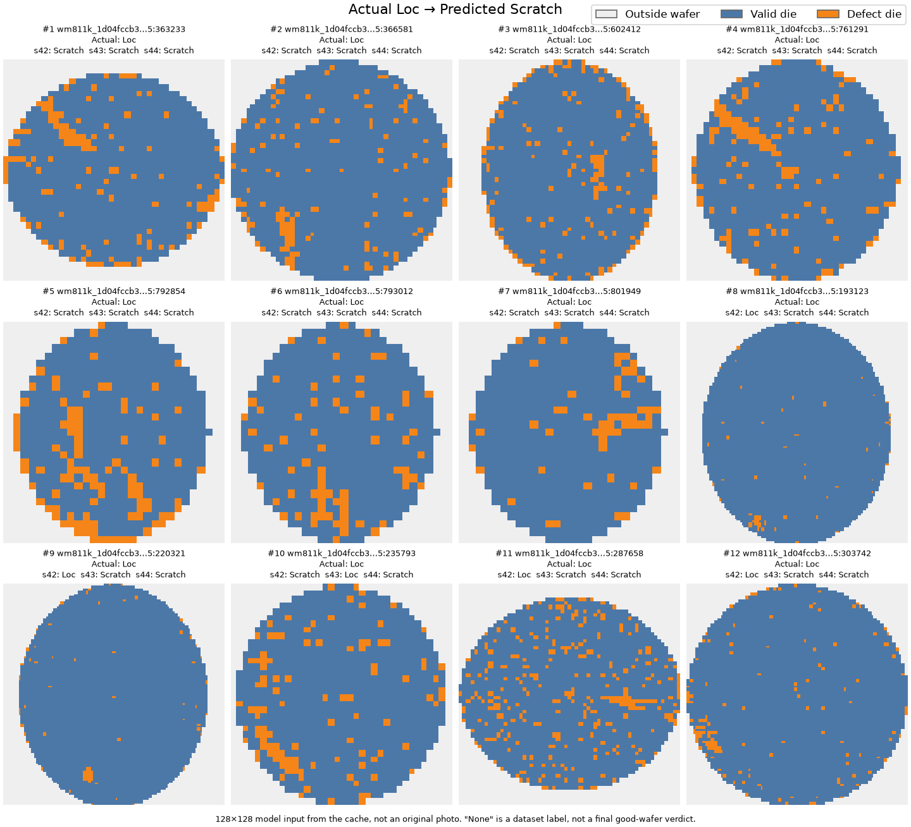
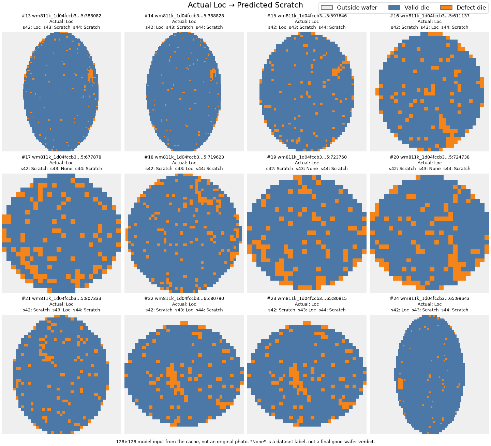
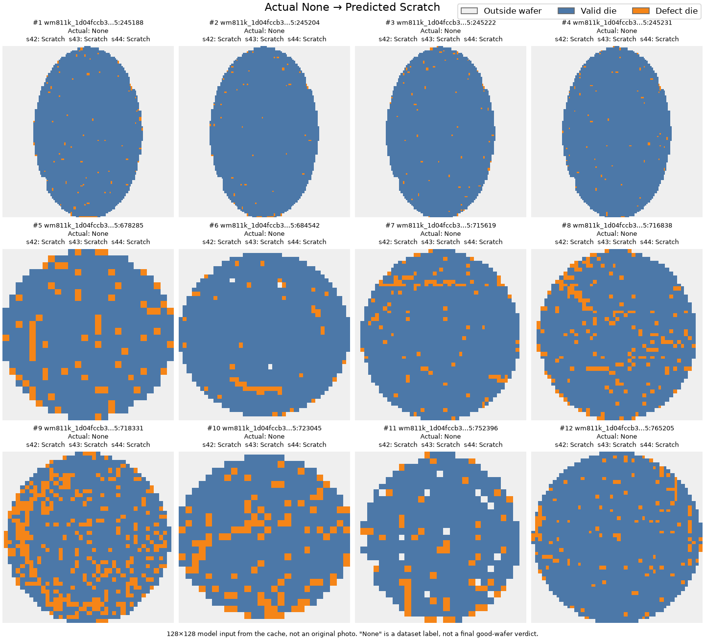
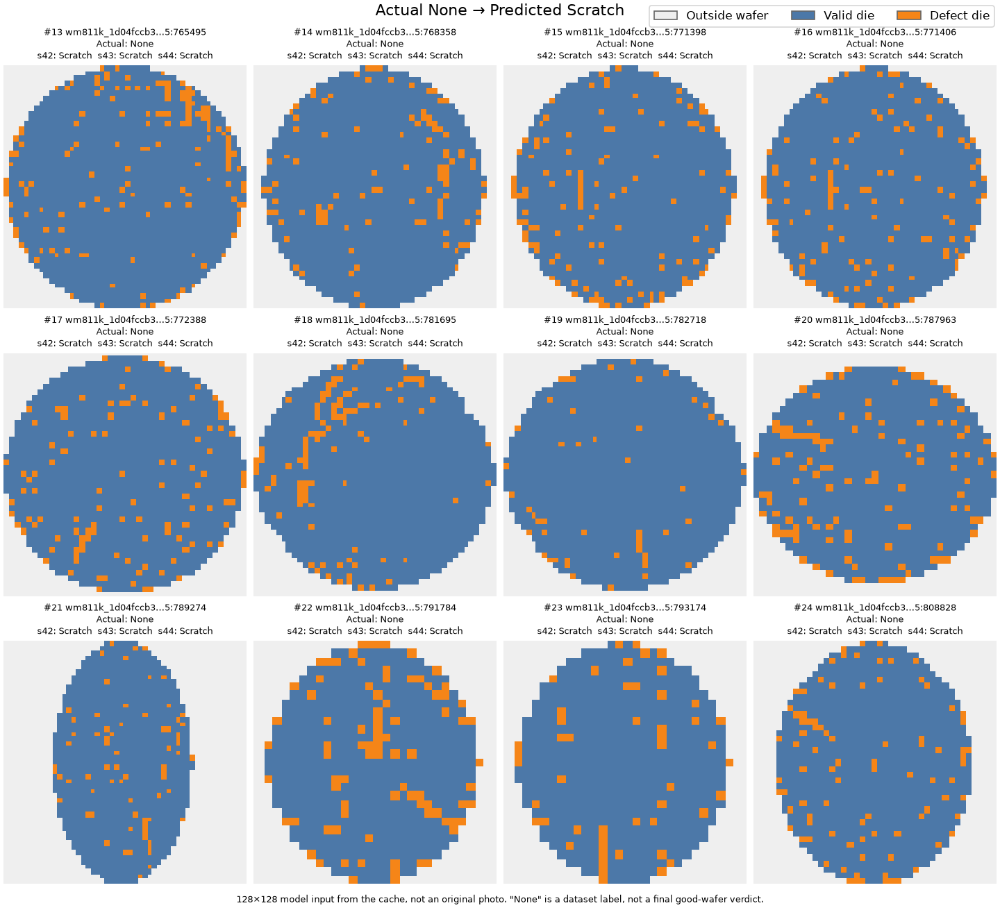
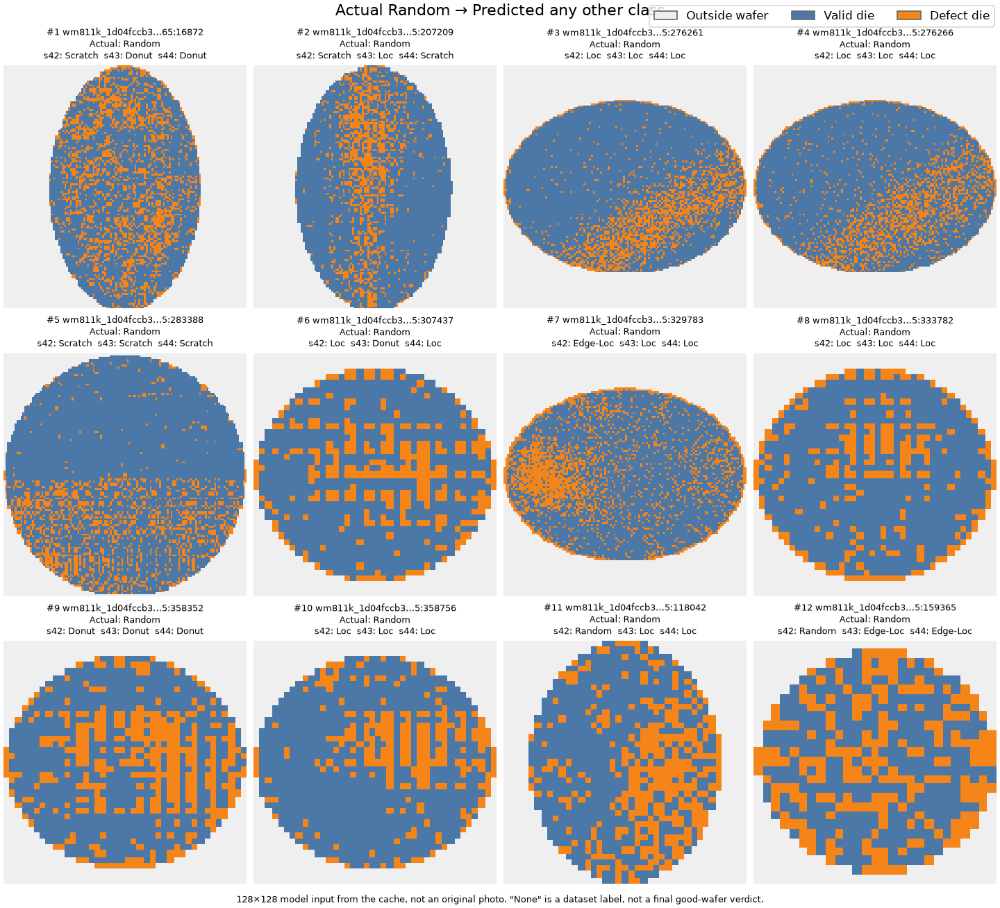
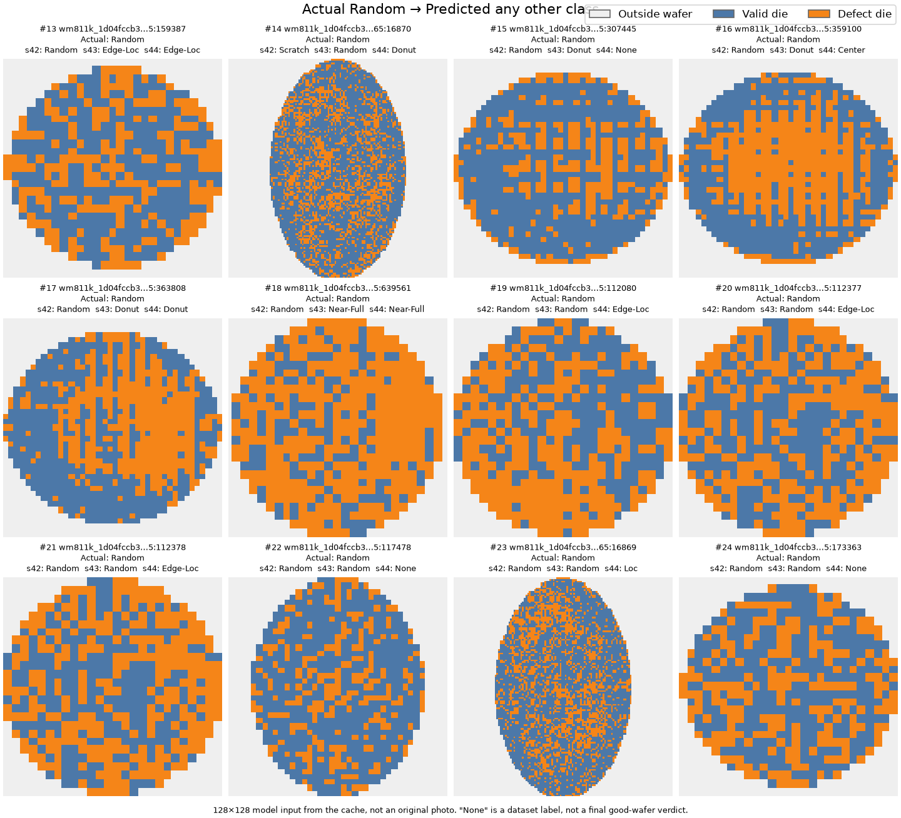

# ResNet18+D4 Validation 오분류 표본 분석

## 범위

Validation 25,827행만 재추론했습니다. Train·Test 배열은 열지 않았고 학습·재학습·앙상블은 없습니다.

증강은 학습 때만 적용되었으며 재추론에는 적용하지 않았습니다. Validation은 checkpoint 선택에 쓰였으므로 아래 수치는 일반화 성능이 아닙니다.

## 입력 식별값

해시는 혼용·변경 확인용이며 인증이 아닙니다.

- 분할 protocol: `wm_split_d02d993fd73c2cc4bf496d54774401c60a94b0d1737c7c135e7ae4837a6b85d6`
- 분할 manifest: `cb584be44cc7aec0bf02b88befdcac1b17aa7810726589e1e06f532a8d851fc5`
- `cache.json`: `d967b8737aaf375d6c3066fb7cb87c068a8580ad0439068f4815e23ffc0269cb`
- 학습 코드: `026d52b681bad5ebcc8a2c497c84128cf73b08f6d496f38ffcc63de20f9bef3f`
- 분석 코드: `b27f425a5776f5676aec86fea38515078aa7f59aba61b41e01901a19698ee7c5`
- 장치: `cuda`, 배치 크기: 64

| seed | selected_epoch | `best_model.pt` | `training_report.json` |
| ---: | ---: | --- | --- |
| 42 | 11 | `d88e9fed9dda9c2d521e192050e573c7908dbe3a73682416b2a9b052d752d285` | `c407bef21f5aa465e4388ee42681de1d15e5c18b43a7415f2e4eab84c9e287a8` |
| 43 | 9 | `98143bb213a81c066784dad67964d0e408200ba97ce28e4bba9745a5057ce0f7` | `a4d5624e9221725b449e2cb2995df9364750ab22cc46a327fded8b1a40b6ecc6` |
| 44 | 6 | `7caebafd297428ab03ee18e2b0f6b4a9f90598adc4dfebad0c3a95979168dce4` | `8d4cd883e3fc325543dd5c84b77e4d3498c785af2b439b00746081a7c6de620e` |

## 재현 대조와 지표

재추론 혼동행렬이 저장된 selected_epoch 혼동행렬과 정확히 같을 때만 "일치"입니다.

| seed | 재현 대조 | Macro-F1 (%) | Scratch Precision (%) | Scratch Recall (%) | Random Precision (%) | Random Recall (%) |
| ---: | --- | ---: | ---: | ---: | ---: | ---: |
| 42 | 일치 | 80.88 | 34.03 | 97.44 | 53.06 | 87.64 |
| 43 | 일치 | 82.29 | 39.22 | 85.47 | 77.42 | 80.90 |
| 44 | 일치 | 81.63 | 33.33 | 90.60 | 98.11 | 58.43 |

## 오류 흐름

seed 합계 상위 10개를 seed별로 표시합니다. 합계는 정렬에만 쓰며, 같은 표본의 반복 예측이라 독립 표본 수가 아닙니다.

| 실제 | 예측 | seed42 | seed43 | seed44 |
| --- | --- | ---: | ---: | ---: |
| None | Scratch | 175 | 111 | 133 |
| None | Edge-Loc | 107 | 70 | 55 |
| Edge-Ring | Edge-Loc | 56 | 87 | 54 |
| Edge-Loc | None | 44 | 50 | 99 |
| None | Loc | 90 | 32 | 22 |
| Edge-Loc | Loc | 21 | 32 | 52 |
| Loc | Scratch | 21 | 23 | 60 |
| Loc | None | 17 | 33 | 41 |
| Center | None | 21 | 22 | 29 |
| Edge-Ring | None | 27 | 17 | 27 |

## 반복 오분류

한 seed 이상에서 틀린 서로 다른 표본(합집합): 1,285개. 처리한 모든 seed에서 틀린 표본(교집합): 259개.

| 오답 seed 수 | 서로 다른 표본 수 |
| ---: | ---: |
| 0 | 24,542 |
| 1 | 693 |
| 2 | 333 |
| 3 | 259 |

## 우선 검토 이미지

선정 기준은 그룹별로 고정했습니다. 해당 오류가 발생한 seed 수 내림차순, 동률은 `sample_id` 오름차순입니다. 그림에서 생략된 표본을 포함한 전체 목록은 `priority_errors.csv`에 있습니다.

이미지는 캐시의 128×128 모델 입력을 3색으로 합성한 것이며 원본 사진이 아닙니다. 추가 회전·반전은 없습니다. 범례: Outside wafer `#EFEFEF`, Valid die `#4C78A8`, Defect die `#F58518`.

`None`은 데이터셋 라벨이며 최종 양품 판정이 아닙니다.

### Actual Loc → Predicted Scratch

- 실제 Loc 표본: 390개
- 서로 다른 오류 표본: 73개
- 모든 처리 seed에서 같은 조건으로 틀린 표본: 7개
- seed별 오류 건수: seed42 21건, seed43 23건, seed44 60건
- 그림 포함 24개, 생략 49개

| 번호 | sample_id | 오류 seed 수 |
| ---: | --- | ---: |
| 1 | `wm811k_1d04fccb3dd3176b276878b926b20fead7e077c5751e4d353ea9741a5e7b5c65:363233` | 3 |
| 2 | `wm811k_1d04fccb3dd3176b276878b926b20fead7e077c5751e4d353ea9741a5e7b5c65:366581` | 3 |
| 3 | `wm811k_1d04fccb3dd3176b276878b926b20fead7e077c5751e4d353ea9741a5e7b5c65:602412` | 3 |
| 4 | `wm811k_1d04fccb3dd3176b276878b926b20fead7e077c5751e4d353ea9741a5e7b5c65:761291` | 3 |
| 5 | `wm811k_1d04fccb3dd3176b276878b926b20fead7e077c5751e4d353ea9741a5e7b5c65:792854` | 3 |
| 6 | `wm811k_1d04fccb3dd3176b276878b926b20fead7e077c5751e4d353ea9741a5e7b5c65:793012` | 3 |
| 7 | `wm811k_1d04fccb3dd3176b276878b926b20fead7e077c5751e4d353ea9741a5e7b5c65:801949` | 3 |
| 8 | `wm811k_1d04fccb3dd3176b276878b926b20fead7e077c5751e4d353ea9741a5e7b5c65:193123` | 2 |
| 9 | `wm811k_1d04fccb3dd3176b276878b926b20fead7e077c5751e4d353ea9741a5e7b5c65:220321` | 2 |
| 10 | `wm811k_1d04fccb3dd3176b276878b926b20fead7e077c5751e4d353ea9741a5e7b5c65:235793` | 2 |
| 11 | `wm811k_1d04fccb3dd3176b276878b926b20fead7e077c5751e4d353ea9741a5e7b5c65:287658` | 2 |
| 12 | `wm811k_1d04fccb3dd3176b276878b926b20fead7e077c5751e4d353ea9741a5e7b5c65:303742` | 2 |
| 13 | `wm811k_1d04fccb3dd3176b276878b926b20fead7e077c5751e4d353ea9741a5e7b5c65:388082` | 2 |
| 14 | `wm811k_1d04fccb3dd3176b276878b926b20fead7e077c5751e4d353ea9741a5e7b5c65:388828` | 2 |
| 15 | `wm811k_1d04fccb3dd3176b276878b926b20fead7e077c5751e4d353ea9741a5e7b5c65:597646` | 2 |
| 16 | `wm811k_1d04fccb3dd3176b276878b926b20fead7e077c5751e4d353ea9741a5e7b5c65:611137` | 2 |
| 17 | `wm811k_1d04fccb3dd3176b276878b926b20fead7e077c5751e4d353ea9741a5e7b5c65:677878` | 2 |
| 18 | `wm811k_1d04fccb3dd3176b276878b926b20fead7e077c5751e4d353ea9741a5e7b5c65:719623` | 2 |
| 19 | `wm811k_1d04fccb3dd3176b276878b926b20fead7e077c5751e4d353ea9741a5e7b5c65:723760` | 2 |
| 20 | `wm811k_1d04fccb3dd3176b276878b926b20fead7e077c5751e4d353ea9741a5e7b5c65:724738` | 2 |
| 21 | `wm811k_1d04fccb3dd3176b276878b926b20fead7e077c5751e4d353ea9741a5e7b5c65:807333` | 2 |
| 22 | `wm811k_1d04fccb3dd3176b276878b926b20fead7e077c5751e4d353ea9741a5e7b5c65:80790` | 2 |
| 23 | `wm811k_1d04fccb3dd3176b276878b926b20fead7e077c5751e4d353ea9741a5e7b5c65:80815` | 2 |
| 24 | `wm811k_1d04fccb3dd3176b276878b926b20fead7e077c5751e4d353ea9741a5e7b5c65:99643` | 2 |

### Actual None → Predicted Scratch

- 실제 None 표본: 22,821개
- 서로 다른 오류 표본: 299개
- 모든 처리 seed에서 같은 조건으로 틀린 표본: 24개
- seed별 오류 건수: seed42 175건, seed43 111건, seed44 133건
- 그림 포함 24개, 생략 275개

| 번호 | sample_id | 오류 seed 수 |
| ---: | --- | ---: |
| 1 | `wm811k_1d04fccb3dd3176b276878b926b20fead7e077c5751e4d353ea9741a5e7b5c65:245188` | 3 |
| 2 | `wm811k_1d04fccb3dd3176b276878b926b20fead7e077c5751e4d353ea9741a5e7b5c65:245204` | 3 |
| 3 | `wm811k_1d04fccb3dd3176b276878b926b20fead7e077c5751e4d353ea9741a5e7b5c65:245222` | 3 |
| 4 | `wm811k_1d04fccb3dd3176b276878b926b20fead7e077c5751e4d353ea9741a5e7b5c65:245231` | 3 |
| 5 | `wm811k_1d04fccb3dd3176b276878b926b20fead7e077c5751e4d353ea9741a5e7b5c65:678285` | 3 |
| 6 | `wm811k_1d04fccb3dd3176b276878b926b20fead7e077c5751e4d353ea9741a5e7b5c65:684542` | 3 |
| 7 | `wm811k_1d04fccb3dd3176b276878b926b20fead7e077c5751e4d353ea9741a5e7b5c65:715619` | 3 |
| 8 | `wm811k_1d04fccb3dd3176b276878b926b20fead7e077c5751e4d353ea9741a5e7b5c65:716838` | 3 |
| 9 | `wm811k_1d04fccb3dd3176b276878b926b20fead7e077c5751e4d353ea9741a5e7b5c65:718331` | 3 |
| 10 | `wm811k_1d04fccb3dd3176b276878b926b20fead7e077c5751e4d353ea9741a5e7b5c65:723045` | 3 |
| 11 | `wm811k_1d04fccb3dd3176b276878b926b20fead7e077c5751e4d353ea9741a5e7b5c65:752396` | 3 |
| 12 | `wm811k_1d04fccb3dd3176b276878b926b20fead7e077c5751e4d353ea9741a5e7b5c65:765205` | 3 |
| 13 | `wm811k_1d04fccb3dd3176b276878b926b20fead7e077c5751e4d353ea9741a5e7b5c65:765495` | 3 |
| 14 | `wm811k_1d04fccb3dd3176b276878b926b20fead7e077c5751e4d353ea9741a5e7b5c65:768358` | 3 |
| 15 | `wm811k_1d04fccb3dd3176b276878b926b20fead7e077c5751e4d353ea9741a5e7b5c65:771398` | 3 |
| 16 | `wm811k_1d04fccb3dd3176b276878b926b20fead7e077c5751e4d353ea9741a5e7b5c65:771406` | 3 |
| 17 | `wm811k_1d04fccb3dd3176b276878b926b20fead7e077c5751e4d353ea9741a5e7b5c65:772388` | 3 |
| 18 | `wm811k_1d04fccb3dd3176b276878b926b20fead7e077c5751e4d353ea9741a5e7b5c65:781695` | 3 |
| 19 | `wm811k_1d04fccb3dd3176b276878b926b20fead7e077c5751e4d353ea9741a5e7b5c65:782718` | 3 |
| 20 | `wm811k_1d04fccb3dd3176b276878b926b20fead7e077c5751e4d353ea9741a5e7b5c65:787963` | 3 |
| 21 | `wm811k_1d04fccb3dd3176b276878b926b20fead7e077c5751e4d353ea9741a5e7b5c65:789274` | 3 |
| 22 | `wm811k_1d04fccb3dd3176b276878b926b20fead7e077c5751e4d353ea9741a5e7b5c65:791784` | 3 |
| 23 | `wm811k_1d04fccb3dd3176b276878b926b20fead7e077c5751e4d353ea9741a5e7b5c65:793174` | 3 |
| 24 | `wm811k_1d04fccb3dd3176b276878b926b20fead7e077c5751e4d353ea9741a5e7b5c65:808828` | 3 |

### Actual Random → Predicted any other class

- 실제 Random 표본: 89개
- 서로 다른 오류 표본: 37개
- 모든 처리 seed에서 같은 조건으로 틀린 표본: 10개
- seed별 오류 건수: seed42 11건, seed43 17건, seed44 37건
- 그림 포함 24개, 생략 13개

| 번호 | sample_id | 오류 seed 수 |
| ---: | --- | ---: |
| 1 | `wm811k_1d04fccb3dd3176b276878b926b20fead7e077c5751e4d353ea9741a5e7b5c65:16872` | 3 |
| 2 | `wm811k_1d04fccb3dd3176b276878b926b20fead7e077c5751e4d353ea9741a5e7b5c65:207209` | 3 |
| 3 | `wm811k_1d04fccb3dd3176b276878b926b20fead7e077c5751e4d353ea9741a5e7b5c65:276261` | 3 |
| 4 | `wm811k_1d04fccb3dd3176b276878b926b20fead7e077c5751e4d353ea9741a5e7b5c65:276266` | 3 |
| 5 | `wm811k_1d04fccb3dd3176b276878b926b20fead7e077c5751e4d353ea9741a5e7b5c65:283388` | 3 |
| 6 | `wm811k_1d04fccb3dd3176b276878b926b20fead7e077c5751e4d353ea9741a5e7b5c65:307437` | 3 |
| 7 | `wm811k_1d04fccb3dd3176b276878b926b20fead7e077c5751e4d353ea9741a5e7b5c65:329783` | 3 |
| 8 | `wm811k_1d04fccb3dd3176b276878b926b20fead7e077c5751e4d353ea9741a5e7b5c65:333782` | 3 |
| 9 | `wm811k_1d04fccb3dd3176b276878b926b20fead7e077c5751e4d353ea9741a5e7b5c65:358352` | 3 |
| 10 | `wm811k_1d04fccb3dd3176b276878b926b20fead7e077c5751e4d353ea9741a5e7b5c65:358756` | 3 |
| 11 | `wm811k_1d04fccb3dd3176b276878b926b20fead7e077c5751e4d353ea9741a5e7b5c65:118042` | 2 |
| 12 | `wm811k_1d04fccb3dd3176b276878b926b20fead7e077c5751e4d353ea9741a5e7b5c65:159365` | 2 |
| 13 | `wm811k_1d04fccb3dd3176b276878b926b20fead7e077c5751e4d353ea9741a5e7b5c65:159387` | 2 |
| 14 | `wm811k_1d04fccb3dd3176b276878b926b20fead7e077c5751e4d353ea9741a5e7b5c65:16870` | 2 |
| 15 | `wm811k_1d04fccb3dd3176b276878b926b20fead7e077c5751e4d353ea9741a5e7b5c65:307445` | 2 |
| 16 | `wm811k_1d04fccb3dd3176b276878b926b20fead7e077c5751e4d353ea9741a5e7b5c65:359100` | 2 |
| 17 | `wm811k_1d04fccb3dd3176b276878b926b20fead7e077c5751e4d353ea9741a5e7b5c65:363808` | 2 |
| 18 | `wm811k_1d04fccb3dd3176b276878b926b20fead7e077c5751e4d353ea9741a5e7b5c65:639561` | 2 |
| 19 | `wm811k_1d04fccb3dd3176b276878b926b20fead7e077c5751e4d353ea9741a5e7b5c65:112080` | 1 |
| 20 | `wm811k_1d04fccb3dd3176b276878b926b20fead7e077c5751e4d353ea9741a5e7b5c65:112377` | 1 |
| 21 | `wm811k_1d04fccb3dd3176b276878b926b20fead7e077c5751e4d353ea9741a5e7b5c65:112378` | 1 |
| 22 | `wm811k_1d04fccb3dd3176b276878b926b20fead7e077c5751e4d353ea9741a5e7b5c65:117478` | 1 |
| 23 | `wm811k_1d04fccb3dd3176b276878b926b20fead7e077c5751e4d353ea9741a5e7b5c65:16869` | 1 |
| 24 | `wm811k_1d04fccb3dd3176b276878b926b20fead7e077c5751e4d353ea9741a5e7b5c65:173363` | 1 |

## 해석 구분

### 실행 기록으로 확인된 사실

- 클래스 가중치 사용: True, 상한 10.0. 오류 원인이라는 뜻은 아닙니다.
- `predicted_probability`는 모델 softmax 출력이며 보정된 신뢰도가 아닙니다.

### 시각적 관찰과 가설

이미지를 사람이 확인한 뒤 작성합니다. 이 보고서는 라벨 오류나 가중치 문제를 판정하지 않으며, 예측을 근거로 원본 라벨을 수정하지 않습니다.
